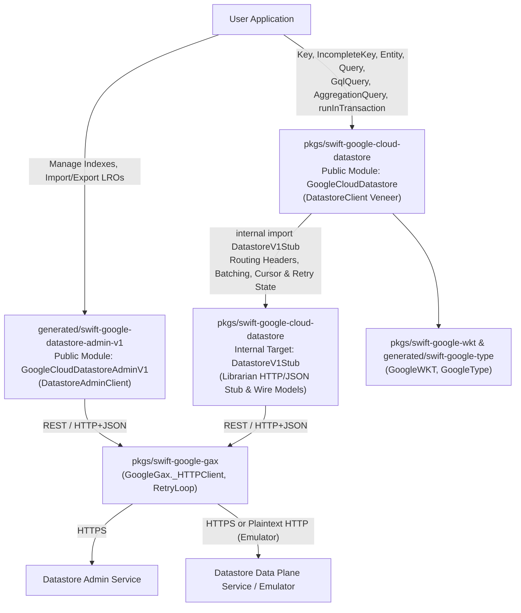

# Google Cloud Datastore Swift Client Library Specification (`GoogleCloudDatastore`)

**Status:** Draft Specification  
**Target Package:** `pkgs/swift-google-cloud-datastore` (`GoogleCloudDatastore`)  
**Control-Plane Package:** `generated/swift-google-datastore-admin-v1` (`GoogleCloudDatastoreAdminV1`)  
**Base Specification:** [Cloud Datastore Client Library Specification (Language-Agnostic Veneer Design)](https://artifax.corp.goog/aa90b6a18f4dae3e)  
**APIs Covered:** `google.datastore.v1` (Data Plane) & `google.datastore.admin.v1` (Control Plane)

---

## 1. Executive Summary & Purpose

Cloud Datastore (`google.datastore.v1`) is a highly scalable NoSQL document database built for automatic scaling, high performance, and ease of application development. Unlike standard Google Cloud control-plane APIs—where auto-generated GAPIC clients provide an ergonomic developer experience—the raw `google.datastore.v1.Datastore` wire protocol is low-level and error-prone to consume directly:

- Every property value is wrapped in a deeply nested `google.datastore.v1.Value` union with per-element indexing rules (such as the array `exclude_from_indexes` constraint).
- Every request requires repeating `project_id`, `database_id`, and `PartitionId` metadata alongside routing headers (`x-goog-request-params` and `google-cloud-resource-prefix`).
- Batch point reads (`Lookup`) may return partial results in `LookupResponse.deferred`, unordered `found`/`missing` lists, and fail or waste quota when duplicate keys are sent.
- Query execution (`RunQuery`) returns single batches that may terminate early (`NOT_FINISHED`) with `skipped_results` and continuation cursors, or switch from a `GqlQuery` to a compiled structured `Query` mid-stream.
- Transactions require lazy initiation (`ReadOptions.new_transaction`), mutation buffering, `PendingKey` resolution for incomplete keys, and optimistic concurrency retry loops passing `previous_transaction` tokens on `ABORTED` errors.

This document specifies the **Swift-specific architecture and public API surface** for `GoogleCloudDatastore` (`pkgs/swift-google-cloud-datastore`), refining the [Language-Agnostic Cloud Datastore Client Library Specification](https://artifax.corp.goog/aa90b6a18f4dae3e) into an idiomatic Swift 6 library with strict concurrency (`Sendable`), value-oriented domain types, and `AsyncSequence` streaming.

---

## 2. Reference Architecture & Package Organization

### 2.1 Separate Control-Plane GAPIC and Data-Plane Veneer Packages

Following the language-agnostic reference architecture (Section 2) and our design decisions (Appendix B, Q1), the Swift SDK separates **Control Plane (Admin)** and **Data Plane** operations into two distinct Swift packages:

1. **Control Plane (`google.datastore.admin.v1`):**
   - **Package Path:** `generated/swift-google-datastore-admin-v1`
   - **Product / Module:** `GoogleCloudDatastoreAdminV1`
   - **Client:** Auto-generated `DatastoreAdminClient`
   - **Scope:** Index management (`CreateIndex`, `DeleteIndex`, `GetIndex`, `ListIndexes`), entity import/export via Long-Running Operations (`ExportEntities`, `ImportEntities`), and Datastore-to-Firestore migration operations.
2. **Data Plane (`google.datastore.v1`):**
   - **Package Path:** `pkgs/swift-google-cloud-datastore`
   - **Public Product / Module:** `GoogleCloudDatastore`
   - **Internal Generated Target:** `DatastoreV1Stub` (`pkgs/swift-google-cloud-datastore/Sources/generated/DatastoreV1Stub`)
   - **Client:** Handwritten `DatastoreClient` conforming to `DatastoreProtocol`
   - **Scope:** All data-plane operations (`Lookup`, `RunQuery`, `RunAggregationQuery`, `BeginTransaction`, `Commit`, `Rollback`, `AllocateIds`, `ReserveIds`).



### 2.2 Transport Layer & Internal `DatastoreV1Stub` Target

Per Appendix B (Q2), `GoogleCloudDatastore` uses **HTTP/JSON** (`GoogleGax._HTTPClient`) backed by a `librarian`-generated `default` module placed in an **internal Swift Package Manager target** (`DatastoreV1Stub`):

- **Hidden Raw GAPIC Surface:** `pkgs/swift-google-cloud-datastore/Package.swift` exports only the `GoogleCloudDatastore` library product. `DatastoreV1Stub` is a package-internal target imported by `GoogleCloudDatastore` via `internal import DatastoreV1Stub`.
- **Zero Name Collisions:** Because `DatastoreV1Stub` is never re-exported publicly, its generated wire models (`DatastoreV1Stub.Key`, `DatastoreV1Stub.Entity`, `DatastoreV1Stub.Value`, `DatastoreV1Stub.Query`, `DatastoreV1Stub.Mutation`) remain strictly internal and never collide with the veneer's ergonomic public types (`GoogleCloudDatastore.Key`, `GoogleCloudDatastore.Entity`, etc.).
- **Minimal External Dependencies:** By using the HTTP/JSON sidekick transport and deferring URL-safe protobuf `Key` serialization (Section 4.4), `GoogleCloudDatastore` depends only on `GoogleGax`, `GoogleWKT`, and `GoogleType`, avoiding `grpc-swift` and `swift-protobuf` dependencies.

### 2.3 Directory Layout

```text
pkgs/swift-google-cloud-datastore/
├── Package.swift
├── README.md
├── GEMINI.md
├── .spi.yml
├── Sources/
│   ├── generated/
│   │   └── DatastoreV1Stub/          # Internal target generated by librarian (google/datastore/v1)
│   └── GoogleCloudDatastore/         # Public handwritten veneer module
│       ├── generated/
│       │   └── version/              # PackageVersion.swift generated by librarian
│       ├── DatastoreClientOptions.swift
│       ├── DatastoreProtocol.swift
│       ├── DatastoreClient.swift
│       ├── Key.swift
│       ├── Key+Convert.swift
│       ├── Value.swift
│       ├── Entity.swift
│       ├── Entity+Convert.swift
│       ├── ReadOptions.swift
│       ├── Mutation.swift
│       ├── Mutation+Convert.swift
│       ├── Transaction.swift
│       ├── Query.swift
│       ├── GqlQuery.swift
│       ├── AggregationQuery.swift
│       ├── QueryProfile.swift
│       ├── DatastoreClient+Lookup.swift
│       ├── DatastoreClient+Mutate.swift
│       ├── DatastoreClient+Query.swift
│       └── DatastoreClient+Aggregation.swift
└── Tests/
    └── GoogleCloudDatastoreTests/
```

---

## 3. Client Configuration, Partition Context & Transport

### 3.1 `DatastoreClientOptions` & Partition Context Binding

Every Datastore entity and query belongs to a logical partition identified by `PartitionId` (`projectId`, `databaseId`, `namespaceId`). `DatastoreClient` is initialized with `DatastoreClientOptions`, which binds the client to a project, database, and default namespace:

```swift
import GoogleGax

/// Configuration options for `DatastoreClient`.
public struct DatastoreClientOptions: Sendable {
  /// Standard GoogleGax client networking, authentication, retry, and telemetry options.
  public var client: GoogleGax.ClientOptions

  /// The Google Cloud project ID.
  public var projectId: String

  /// The target Datastore database ID within the project.
  ///
  /// The default database is represented by the empty string `""`.
  public var databaseId: String

  /// The default multi-tenant namespace ID applied to keys and queries created
  /// through this client when not explicitly overridden.
  public var namespaceId: String

  /// Maximum number of attempts for `runInTransaction` when retrying on contention (`ABORTED`).
  public var maxTransactionAttempts: Int

  /// Backoff policy used between transaction retry attempts.
  public var transactionBackoffPolicy: any GoogleGax.BackoffPolicy

  /// Creates configuration options for a `DatastoreClient`.
  /// - Parameters:
  ///   - projectId: The Google Cloud project ID.
  ///   - databaseId: The database ID (defaults to `""` for the default database).
  ///   - namespaceId: The default namespace ID (defaults to `""`).
  ///   - maxTransactionAttempts: Max transaction attempts (defaults to `5`).
  ///   - transactionBackoffPolicy: Backoff policy between transaction retries.
  ///   - client: Underlying `GoogleGax.ClientOptions`.
  public init(
    projectId: String,
    databaseId: String = "",
    namespaceId: String = "",
    maxTransactionAttempts: Int = 5,
    transactionBackoffPolicy: any GoogleGax.BackoffPolicy = ExponentialBackoff(),
    client: GoogleGax.ClientOptions = .init()
  )

  /// Returns a modified copy of `DatastoreClientOptions`.
  public func with(_ config: (inout Self) throws -> Void) rethrows -> Self {
    var copy = self
    try config(&copy)
    return copy
  }
}
```

#### Database ID Normalization:
On the wire, Cloud Datastore represents the default database as the empty string `""` (not `"(default)"`). `DatastoreClientOptions.databaseId` defaults to `""`. When constructing wire requests or validating input keys, the veneer stamps its bound `projectId` and `databaseId` automatically so callers do not repeat them on every operation.

### 3.2 Required Routing Metadata Headers

On every outgoing data-plane RPC (`Lookup`, `RunQuery`, `RunAggregationQuery`, `BeginTransaction`, `Commit`, `Rollback`, `AllocateIds`, `ReserveIds`), `DatastoreClient` attaches the following HTTP headers via `RequestOptions`:

1. **`x-goog-request-params`:**
   - When `databaseId.isEmpty`: `project_id=\(urlEncodedProjectId)`
   - When `!databaseId.isEmpty`: `project_id=\(urlEncodedProjectId)&database_id=\(urlEncodedDatabaseId)`
2. **`google-cloud-resource-prefix`:**
   - When `databaseId.isEmpty`: `projects/\(projectId)`
   - When `!databaseId.isEmpty`: `projects/\(projectId)/databases/\(databaseId)`

### 3.3 Cloud Datastore Emulator Support (`DATASTORE_EMULATOR_HOST`)

During `DatastoreClient.init(_ options: DatastoreClientOptions)`, the client checks the `DATASTORE_EMULATOR_HOST` environment variable (e.g., `"localhost:8081"`):

- If `DATASTORE_EMULATOR_HOST` is set and non-empty:
  - If `options.client.endpoint` was not explicitly overridden by the caller, the client routes all data-plane requests to `http://\(emulatorHost)` (prepending `http://` if no scheme is present).
  - If `options.client.credentials` was not explicitly provided by the caller, the client configures an anonymous / no-op `HeaderProvider` so requests to the local emulator do not attempt Google Application Default Credentials (ADC) token exchange.

### 3.4 Endpoint, Universe Domain & RPC Idempotency

- **Custom Endpoints & Universe Domain:** Callers can override `options.client.endpoint` for regional or Trusted Partner Cloud (TPC) endpoints.
- **RPC Idempotency & Retry Classification:**
  - **Idempotent RPCs (Safe for automatic RPC-level retry via `GoogleGax.RetryPolicy`):** `Lookup`, `RunQuery`, `RunAggregationQuery`, `ReserveIds`.
  - **Non-Idempotent / Stateful RPCs:** `Commit`, `BeginTransaction`, `Rollback`, `AllocateIds`. Transactional `Commit` retries are orchestrated at the whole-transaction closure level in `runInTransaction` (Section 8), never by blindly re-sending a single `CommitRequest`.

---

## 4. Keys & Key ID Management

### 4.1 Static Key Hierarchy: `Key` vs. `IncompleteKey`

Per Section 4.2 of the language-agnostic specification and Appendix B (Q3), `GoogleCloudDatastore` models complete and incomplete keys as **separate static types** (`Key` and `IncompleteKey`):

- A **`Key`** represents a complete key where every `PathElement` (all ancestors and the leaf element) has either a non-zero `Int64` ID or a non-empty `String` name.
- An **`IncompleteKey`** represents a partial key whose ancestor `PathElement`s are all complete, but whose leaf element specifies only a `kind: String` (with no ID or name).
- **Compile-Time Safety:** Operations that require a complete key (`get`, `getMulti`, `update`, `delete`, `reserveIds`, `reserveIdsSequential`, `Query.hasAncestor`, and parent key parameters) accept `Key` and reject `IncompleteKey` at compile time.

```swift
/// Identifies the logical partition (project, database, and namespace) of a Datastore key or query.
public struct PartitionId: Sendable, Hashable, Codable {
  public var projectId: String
  public var databaseId: String
  public var namespaceId: String

  public init(projectId: String = "", databaseId: String = "", namespaceId: String = "") {
    self.projectId = projectId
    self.databaseId = databaseId
    self.namespaceId = namespaceId
  }
}

/// A completed element in a key's path (kind plus either a numeric ID or string name).
public struct PathElement: Sendable, Hashable, Codable {
  /// The identifier of a completed `PathElement`.
  public enum ID: Sendable, Hashable, Codable {
    /// A non-zero 64-bit signed integer ID.
    case id(Int64)
    /// A non-empty UTF-8 string name.
    case name(String)
  }

  /// The entity kind (non-empty string).
  public var kind: String
  /// The element's numeric ID or string name.
  public var id: ID

  public init(kind: String, id: Int64)
  public init(kind: String, name: String)
  public init(kind: String, id: ID)
}

/// An incomplete Datastore key whose leaf element has a `kind` but no `id` or `name`.
///
/// Used exclusively with `insert`, `upsert`, or `allocateIds` so the server allocates
/// a unique numeric `Int64` ID.
public struct IncompleteKey: Sendable, Hashable, Codable {
  public var partitionId: PartitionId
  /// Completed ancestor path elements (parent, grandparent, etc.), ordered from root to parent.
  public var ancestors: [PathElement]
  /// The entity kind of the leaf element.
  public var kind: String

  public init(
    kind: String,
    parent: Key? = nil,
    partitionId: PartitionId = .init()
  )

  /// Returns a complete `Key` by assigning a numeric `Int64` ID to this incomplete key's leaf.
  public func completed(id: Int64) -> Key

  /// Returns a complete `Key` by assigning a string `name` to this incomplete key's leaf.
  public func completed(name: String) -> Key
}

/// A complete Datastore key where every element in the path (ancestors and leaf)
/// has a non-zero numeric `id` or a non-empty string `name`.
public struct Key: Sendable, Hashable, Codable {
  public var partitionId: PartitionId
  /// Completed ancestor path elements, ordered from root to immediate parent.
  public var ancestors: [PathElement]
  /// The completed leaf element identifying this entity.
  public var leaf: PathElement

  /// Full path including `ancestors` followed by `leaf`.
  public var path: [PathElement] { ancestors + [leaf] }
  /// The leaf entity kind.
  public var kind: String { leaf.kind }
  /// The leaf identifier (`.id(Int64)` or `.name(String)`).
  public var id: PathElement.ID { leaf.id }
  /// The immediate parent `Key`, or `nil` if this is a root key.
  public var parent: Key?

  public init(
    kind: String,
    id: Int64,
    parent: Key? = nil,
    partitionId: PartitionId = .init()
  )

  public init(
    kind: String,
    name: String,
    parent: Key? = nil,
    partitionId: PartitionId = .init()
  )

  public init(
    ancestors: [PathElement] = [],
    leaf: PathElement,
    partitionId: PartitionId = .init()
  )
}
```

### 4.2 Client-Bound Key Factories

To avoid repeating `projectId`, `databaseId`, and `namespaceId`, `DatastoreClient` provides convenience factory methods bound to the client's partition context:

```swift
extension DatastoreClient {
  /// Creates an `IncompleteKey` bound to this client's `projectId`, `databaseId`, and `namespaceId`.
  public func incompleteKey(
    kind: String,
    parent: Key? = nil,
    namespaceId: String? = nil
  ) -> IncompleteKey

  /// Creates a complete `Key` with a numeric `Int64` ID bound to this client's partition.
  public func key(
    kind: String,
    id: Int64,
    parent: Key? = nil,
    namespaceId: String? = nil
  ) -> Key

  /// Creates a complete `Key` with a string `name` bound to this client's partition.
  public func key(
    kind: String,
    name: String,
    parent: Key? = nil,
    namespaceId: String? = nil
  ) -> Key

  /// Creates a complete `Key` from an ancestor chain of `PathElement`s and a leaf `PathElement`.
  public func key(
    ancestors: [PathElement],
    leaf: PathElement,
    namespaceId: String? = nil
  ) -> Key
}
```

### 4.3 URL-Safe Key Serialization (Deferred)

Per Appendix B (Q2), URL-safe Base64 `google.datastore.v1.Key` protobuf serialization (`toUrlSafe()` / `fromUrlSafe(_:)`) is **deferred** from the initial implementation to keep `GoogleCloudDatastore` free of a `SwiftProtobuf` dependency. Because `Key` and `IncompleteKey` conform to `Codable`, callers within Swift ecosystems can serialize keys using standard `JSONEncoder`/`JSONDecoder`. Standard `google.datastore.v1.Key` wire protobuf encoding can be added in a future minor release (either via a tiny hand-rolled protobuf wire encoder for `PartitionId` + `PathElement` or an optional `SwiftProtobuf` target) without breaking source compatibility.

### 4.4 Key ID Allocation & Reservation RPCs

```swift
extension DatastoreProtocol {
  /// Allocates unique numeric IDs for a batch of incomplete keys (`AllocateIds`).
  ///
  /// - Parameters:
  ///   - keys: Incomplete keys for which the server should allocate numeric IDs.
  ///   - options: Optional per-request options.
  /// - Returns: Complete `Key`s in the exact same order as `keys`.
  func allocateIds(
    _ keys: [IncompleteKey],
    options: RequestOptions?
  ) async throws -> [Key]

  /// Allocates a unique numeric ID for a single incomplete key (`AllocateIds`).
  func allocateId(
    _ key: IncompleteKey,
    options: RequestOptions?
  ) async throws -> Key

  /// Prevents Datastore's automatic ID generator from assigning any of the given
  /// complete keys' numeric IDs to future entities (`ReserveIds`).
  func reserveIds(
    _ keys: [Key],
    options: RequestOptions?
  ) async throws

  /// Convenience helper that reserves `count` sequential numeric IDs starting at
  /// `startingAt.id` (`startingAt.id ..< startingAt.id + Int64(count)`).
  ///
  /// - Throws: `DatastoreError.invalidArgument` if `startingAt` uses a string `.name`
  ///   instead of a numeric `.id(Int64)` or if `count <= 0`.
  func reserveIdsSequential(
    startingAt key: Key,
    count: Int,
    options: RequestOptions?
  ) async throws
}
```

---

## 5. Entities, Values & Property Metadata

### 5.1 `Value` and `PropertyValue`

`Value` is a Swift `enum` supporting all 11 Datastore wire value types (Section 5.2 of the language-agnostic spec). `PropertyValue` pairs a `Value` with its index configuration (`excludeFromIndexes: Bool`) and internal `meaning: Int32?` metadata:

```swift
import Foundation
import GoogleType
import GoogleWKT

/// Represents one of the 11 supported Cloud Datastore property value types.
public enum Value: Sendable, Equatable {
  /// Explicit null value (`google.protobuf.NullValue`).
  case null
  /// Boolean value (`bool`).
  case bool(Bool)
  /// 64-bit signed integer (`int64`).
  case int64(Int64)
  /// 64-bit IEEE 754 floating-point number (`double`).
  case double(Double)
  /// UTC timestamp (`google.protobuf.Timestamp`), stored at microsecond precision.
  case timestamp(GoogleWKT.WKTTimestamp)
  /// UTF-8 string (`string`). Max 1,500 bytes if indexed; up to 1 MiB if unindexed.
  case string(String)
  /// Raw byte array (`bytes`). Max 1,500 bytes if indexed; up to 1 MiB if unindexed.
  case bytes(Data)
  /// Geographic coordinates (`google.type.LatLng`).
  case geoPoint(GoogleType.LatLng)
  /// Reference to a Datastore `Key` (`google.datastore.v1.Key`).
  case key(Key)
  /// Ordered list of property values (`google.datastore.v1.ArrayValue`).
  /// Note: Datastore prohibits directly nested arrays (`.array` cannot directly contain `.array`).
  case array([PropertyValue])
  /// Nested embedded entity (`google.datastore.v1.Entity`), with or without a `Key`.
  indirect case entity(EmbeddedEntity)
}

/// A Datastore property value together with its indexing and wire metadata.
public struct PropertyValue: Sendable, Equatable {
  /// The typed value of the property.
  public var value: Value
  /// If `true`, prevents Datastore from indexing this property value in built-in and composite indexes.
  public var excludeFromIndexes: Bool
  /// Internal wire `meaning` preserved across read-modify-write cycles.
  internal var meaning: Int32?

  public init(_ value: Value, excludeFromIndexes: Bool = false) {
    self.value = value
    self.excludeFromIndexes = excludeFromIndexes
    self.meaning = nil
  }

  /// Convenience factory for creating an unindexed property value (`excludeFromIndexes = true`).
  public static func unindexed(_ value: Value) -> Self {
    Self(value, excludeFromIndexes: true)
  }
}
```

#### Ergonomic Literal & Value Initializers:
Both `Value` and `PropertyValue` conform to `ExpressibleByNilLiteral`, `ExpressibleByBooleanLiteral`, `ExpressibleByIntegerLiteral`, `ExpressibleByFloatLiteral`, `ExpressibleByStringLiteral`, `ExpressibleByArrayLiteral`, and `ExpressibleByDictionaryLiteral`, allowing concise entity construction:

```swift
var task = IncompleteEntity(
  key: client.incompleteKey(kind: "Task"),
  properties: [
    "title": "Write Datastore Swift Spec",
    "priority": 1,
    "done": false,
    "notes": .unindexed("Long description exceeding 1,500 bytes..."),
    "tags": ["swift", "datastore", "cloud"],
  ]
)
```

### 5.2 Property Metadata Rules: Array Indexing & `meaning` Preservation

1. **Array Indexing Rule (`excludeFromIndexes` Propagation):**
   - On the wire, Cloud Datastore rejects `exclude_from_indexes = true` on a `Value` whose payload is `array_value`. Instead, `exclude_from_indexes` must be set on the individual element `Value`s inside `ArrayValue.values`.
   - When `PropertyValue(value: .array(elements), excludeFromIndexes: true)` is serialized to `DatastoreV1Stub.Value`, the veneer sets `excludeFromIndexes = false` on the outer `ArrayValue` wrapper and propagates `excludeFromIndexes = true` onto every element inside `ArrayValue.values`.
   - Conversely, when decoding an `ArrayValue` from the wire where all non-empty elements have `excludeFromIndexes == true`, `PropertyValue.excludeFromIndexes` reflects the element indexing state.
2. **Internal `meaning` Preservation & Projection Decoding (`meaning = 18`):**
   - When an entity is decoded from `LookupResponse` or `RunQueryResponse`, each `PropertyValue` retains the wire `Value.meaning` integer.
   - If the entity is subsequently passed to `update` or `upsert` without replacing that `PropertyValue`, the original `meaning` is preserved on the outgoing `DatastoreV1Stub.Value`.
   - For projection queries (`ResultType == .projection`), Datastore returns index-only timestamp values as 64-bit microsecond integers with `meaning = 18`. `PropertyValue` preserves `meaning = 18` and provides a `projectedTimestamp: GoogleWKT.WKTTimestamp?` accessor that converts microsecond `int64` values with `meaning = 18` into `WKTTimestamp`.

### 5.3 Three Distinct Entity Structs Conforming to `EntityProtocol`

Per Appendix B (Q5), `GoogleCloudDatastore` defines three concrete structs—`Entity`, `IncompleteEntity`, and `EmbeddedEntity`—all conforming to a shared `EntityProtocol`:

```swift
/// Common interface shared by `Entity`, `IncompleteEntity`, and `EmbeddedEntity`.
public protocol EntityProtocol: Sendable, Equatable {
  /// Dictionary of property names to `PropertyValue`s.
  var properties: [String: PropertyValue] { get set }
}

extension EntityProtocol {
  /// Accesses the `PropertyValue` (value + `excludeFromIndexes`) for `property`.
  public subscript(property: String) -> PropertyValue? {
    get { properties[property] }
    set { properties[property] = newValue }
  }

  /// Accesses the unwrapped `Value` for `property`.
  /// Setting a new `Value` preserves `excludeFromIndexes = false` by default.
  public subscript(value property: String) -> Value? {
    get { properties[property]?.value }
    set {
      if let newValue {
        let existingExclude = properties[property]?.excludeFromIndexes ?? false
        properties[property] = PropertyValue(newValue, excludeFromIndexes: existingExclude)
      } else {
        properties.removeValue(forKey: property)
      }
    }
  }
}

/// A persisted or complete-keyed Datastore entity with a complete `Key`.
public struct Entity: EntityProtocol, Sendable, Equatable {
  /// The complete key uniquely identifying this entity.
  public var key: Key
  /// The entity's properties.
  public var properties: [String: PropertyValue]
  /// The entity's microsecond version number returned by the server (`EntityResult.version`), if known.
  public var version: Int64?
  /// The entity's creation timestamp (`EntityResult.create_time`), if returned by the server.
  public var createTime: GoogleWKT.WKTTimestamp?
  /// The entity's last modification timestamp (`EntityResult.update_time`), if returned by the server.
  public var updateTime: GoogleWKT.WKTTimestamp?

  public init(
    key: Key,
    properties: [String: PropertyValue] = [:],
    version: Int64? = nil,
    createTime: GoogleWKT.WKTTimestamp? = nil,
    updateTime: GoogleWKT.WKTTimestamp? = nil
  )
}

/// A new Datastore entity bound to an `IncompleteKey` whose numeric ID will be
/// allocated by the server upon `insert` or `upsert`.
public struct IncompleteEntity: EntityProtocol, Sendable, Equatable {
  /// The incomplete key specifying the entity's partition, ancestors, and kind.
  public var key: IncompleteKey
  /// The entity's properties.
  public var properties: [String: PropertyValue]

  public init(
    key: IncompleteKey,
    properties: [String: PropertyValue] = [:]
  )
}

/// An entity embedded inside a `Value.entity(EmbeddedEntity)` property of another entity.
public struct EmbeddedEntity: EntityProtocol, Sendable, Equatable {
  /// Optional key associated with the embedded entity.
  public var key: Key?
  /// The embedded entity's properties.
  public var properties: [String: PropertyValue]

  public init(
    key: Key? = nil,
    properties: [String: PropertyValue] = [:]
  )
}
```

### 5.4 Future Enhancement: Native Swift `Codable` Serialization (`EntityEncoder` / `EntityDecoder`)

Per Appendix B (Q4), the initial implementation focuses on the core dynamic `Entity` / `Value` map representation. Native Swift `Codable` serialization (`EntityEncoder` and `EntityDecoder`) is reserved as an additive follow-up enhancement. When introduced in a future PR, `EntityEncoder` / `EntityDecoder` will layer cleanly on top of `[String: PropertyValue]` and support:
- Custom property names via standard `CodingKeys`.
- Property wrappers for `@NoIndex` (`excludeFromIndexes = true`), `@EntityKey` (self-populating `Key?`), and `@Flatten` (dot-separated nested struct flattening).
- Configurable handling for unknown properties on decode.

---

## 6. Point Reads (`Lookup`) & `ReadOptions`

### 6.1 `ReadOptions`

Every non-transactional read operation (`get`, `getMulti`, `runQuery`, `runQueryBatches`, `explainQuery`, `runAggregationQuery`, `explainAggregationQuery`) accepts an optional `ReadOptions`:

```swift
/// Read consistency mode for non-transactional Datastore reads.
public enum ReadConsistency: Sendable, Hashable {
  /// Strongly consistent reads (`ReadConsistency.STRONG`).
  case strong
  /// Eventually consistent reads (`ReadConsistency.EVENTUAL`).
  case eventual
}

/// Options controlling read consistency, snapshot timestamp, and property masking.
public struct ReadOptions: Sendable {
  /// Mutually exclusive consistency selector (`consistency_type` oneof on the wire).
  public enum ConsistencySelector: Sendable, Hashable {
    /// Uses strong or eventual read consistency.
    case consistency(ReadConsistency)
    /// Reads entities from a consistent snapshot at the given UTC timestamp (`read_time`).
    case readTime(GoogleWKT.WKTTimestamp)
  }

  /// The consistency or snapshot timestamp selector. Defaults to `nil` (server default: `.strong`).
  public var selector: ConsistencySelector?
  /// Optional list of property paths to return (`PropertyMask`). If `nil`, all properties are returned.
  public var propertyMask: [String]?
  /// Per-request HTTP / retry options.
  public var requestOptions: RequestOptions?

  public init(
    selector: ConsistencySelector? = nil,
    propertyMask: [String]? = nil,
    requestOptions: RequestOptions? = nil
  )

  public static func consistency(_ consistency: ReadConsistency, propertyMask: [String]? = nil) -> Self
  public static func readTime(_ readTime: GoogleWKT.WKTTimestamp, propertyMask: [String]? = nil) -> Self
}
```

### 6.2 Single and Batch Point Reads (`get` and `getMulti`)

```swift
extension DatastoreProtocol {
  /// Looks up a single entity by its complete `Key`.
  ///
  /// - Returns: The `Entity` if found, or `nil` if the key does not exist.
  func get(
    _ key: Key,
    options: ReadOptions?
  ) async throws -> Entity?

  /// Looks up multiple entities by their complete `Key`s in a batch (`LookupRequest`).
  ///
  /// - Important:
  ///   1. **Key Deduplication:** Duplicate keys in `keys` are automatically deduplicated before sending
  ///      `LookupRequest` and fanned back out to all matching indices in the returned array.
  ///   2. **Automatic `deferred` Retry Loop:** If the backend returns keys in `LookupResponse.deferred`,
  ///      `getMulti` automatically loops with exponential backoff until `deferred` is empty.
  ///   3. **Order Preservation:** The returned `[Entity?]` array has the exact same length and positional
  ///      ordering as the caller's `keys` array, with `nil` at indices corresponding to missing keys.
  func getMulti(
    _ keys: [Key],
    options: ReadOptions?
  ) async throws -> [Entity?]
}
```

---

## 7. Writes, Mutations & Server-Side Property Transforms (`Commit`)

### 7.1 Mutation Types & Server-Side `PropertyTransform`s

`Mutation` models the four core Datastore write operations (`insert`, `upsert`, `update`, `delete`) together with optional optimistic concurrency preconditions (`baseVersion`), partial field masks (`propertyMask`), and atomic server-side `PropertyTransform`s:

```swift
/// An atomic server-side transformation applied to an entity property during `Commit`.
public struct PropertyTransform: Sendable, Equatable {
  internal enum Operation: Sendable, Equatable {
    case setToServerTime
    case increment(Value)
    case maximum(Value)
    case minimum(Value)
    case appendMissingElements([PropertyValue])
    case removeAllFromArray([PropertyValue])
  }

  /// The dot-delimited property path to transform.
  public let propertyPath: String
  internal let operation: Operation

  /// Sets the property to the timestamp at which the server processes the request (`REQUEST_TIME`).
  public static func setToServerTime(_ propertyPath: String) -> Self

  /// Atomically adds `amount` (`Int64`) to the numeric property (initializing to `0 + amount` if missing).
  public static func increment(_ propertyPath: String, by amount: Int64) -> Self

  /// Atomically adds `amount` (`Double`) to the numeric property (initializing to `0.0 + amount` if missing).
  public static func increment(_ propertyPath: String, by amount: Double) -> Self

  /// Atomically sets the property to the greater of its current value and `value` (`Int64`).
  public static func maximum(_ propertyPath: String, _ value: Int64) -> Self

  /// Atomically sets the property to the greater of its current value and `value` (`Double`).
  public static func maximum(_ propertyPath: String, _ value: Double) -> Self

  /// Atomically sets the property to the lesser of its current value and `value` (`Int64`).
  public static func minimum(_ propertyPath: String, _ value: Int64) -> Self

  /// Atomically sets the property to the lesser of its current value and `value` (`Double`).
  public static func minimum(_ propertyPath: String, _ value: Double) -> Self

  /// Atomically appends each element in `elements` that is not already present in the target array property.
  public static func appendMissingElements(_ propertyPath: String, _ elements: [PropertyValue]) -> Self

  /// Atomically removes all occurrences of any element in `elements` from the target array property.
  public static func removeAllFromArray(_ propertyPath: String, _ elements: [PropertyValue]) -> Self
}

/// A single write mutation executed in a `Commit` request or buffered in a `Transaction`.
public struct Mutation: Sendable, Equatable {
  /// Inserts a new entity with a complete `Key`. Fails with `ALREADY_EXISTS` if the key already exists.
  public static func insert(
    _ entity: Entity,
    transforms: [PropertyTransform] = []
  ) -> Self

  /// Inserts a new entity with an `IncompleteKey`, allocating a new numeric ID on the server.
  public static func insert(
    _ entity: IncompleteEntity,
    transforms: [PropertyTransform] = []
  ) -> Self

  /// Upserts an entity with a complete `Key` (overwriting or applying `propertyMask`).
  public static func upsert(
    _ entity: Entity,
    baseVersion: Int64? = nil,
    propertyMask: [String]? = nil,
    transforms: [PropertyTransform] = []
  ) -> Self

  /// Upserts an entity with an `IncompleteKey`, allocating a new numeric ID on the server.
  public static func upsert(
    _ entity: IncompleteEntity,
    transforms: [PropertyTransform] = []
  ) -> Self

  /// Updates an existing entity with a complete `Key`. Fails with `NOT_FOUND` if the key does not exist.
  public static func update(
    _ entity: Entity,
    baseVersion: Int64? = nil,
    propertyMask: [String]? = nil,
    transforms: [PropertyTransform] = []
  ) -> Self

  /// Applies only `PropertyTransform`s to an existing entity without overwriting any existing properties
  /// (sends an empty `PropertyMask()` on the wire).
  public static func transform(
    key: Key,
    baseVersion: Int64? = nil,
    transforms: [PropertyTransform]
  ) -> Self

  /// Deletes the entity with the specified complete `Key`.
  public static func delete(
    _ key: Key,
    baseVersion: Int64? = nil
  ) -> Self
}

/// Result metadata for a single committed `Mutation`.
public struct MutationResult: Sendable, Equatable {
  /// The complete `Key` of the mutated entity (either newly allocated by the server or normalized from the input mutation).
  public let key: Key?
  /// The new version timestamp of the entity after the mutation.
  public let version: Int64
  /// The server timestamp at which the entity was created, if applicable.
  public let createTime: GoogleWKT.WKTTimestamp?
  /// The server timestamp at which the entity was updated.
  public let updateTime: GoogleWKT.WKTTimestamp?
  /// Whether a conflict was detected during the mutation.
  public let conflictDetected: Bool
  /// Values produced by `PropertyTransform`s, in the same order as the request's `transforms`.
  public let transformResults: [PropertyValue]
}
```

### 7.2 Non-Transactional Write Methods on `DatastoreProtocol`

```swift
extension DatastoreProtocol {
  /// Inserts a new entity with a complete `Key`.
  @discardableResult
  func insert(_ entity: Entity, options: RequestOptions?) async throws -> Key

  /// Inserts a new entity with an `IncompleteKey` and returns the newly allocated complete `Key`.
  func insert(_ entity: IncompleteEntity, options: RequestOptions?) async throws -> Key

  /// Upserts an entity with a complete `Key`.
  @discardableResult
  func upsert(_ entity: Entity, options: RequestOptions?) async throws -> Key

  /// Upserts an entity with an `IncompleteKey` and returns the newly allocated complete `Key`.
  func upsert(_ entity: IncompleteEntity, options: RequestOptions?) async throws -> Key

  /// Updates an existing entity with a complete `Key`.
  func update(_ entity: Entity, options: RequestOptions?) async throws

  /// Deletes the entity with the specified complete `Key`.
  func delete(_ key: Key, options: RequestOptions?) async throws

  /// Executes a batch of mutations in a single non-transactional `Commit` RPC.
  ///
  /// - Note: Duplicate `.delete` mutations for the exact same `Key` (with matching `baseVersion`)
  ///   are automatically deduplicated before sending `CommitRequest`.
  @discardableResult
  func mutate(_ mutations: [Mutation], options: RequestOptions?) async throws -> [MutationResult]
}
```

#### Key Normalization & Duplicate Delete Deduplication:
1. **Complete Key Normalization:** When `MutationResult.key` is omitted on the wire (because the input mutation already had a complete `Key`), the veneer populates `MutationResult.key` with the input `Key` so callers always receive a non-nil `Key` for `insert`, `upsert`, and `update` mutations.
2. **Transform-Only `PropertyMask`:** When `Mutation.transform(key:baseVersion:transforms:)` is used (or when an empty `propertyMask: []` is supplied), the veneer sends an initialized `DatastoreV1Stub.PropertyMask(paths: [])` so Datastore applies only `property_transforms` without wiping existing properties.
3. **Duplicate `delete` Coalescing:** If a `[Mutation]` batch contains multiple `.delete` entries targeting the same `Key`, the veneer coalesces them in `CommitRequest` to avoid `INVALID_ARGUMENT` errors from Datastore, and maps the resulting `MutationResult` back to the caller's indices.

---

## 8. Transactions (`runInTransaction`)

### 8.1 Closure-Only Auto-Retrying Transaction Surface

Per Section 8 of the language-agnostic specification and Appendix B (Q6), `GoogleCloudDatastore` exposes **only** the closure-based auto-retrying transaction runner (`runInTransaction`). Manual `beginTransaction` handles are intentionally omitted so transactions cannot be leaked across structured concurrency tasks or forgotten without rollback.

```swift
/// Options configuring a Datastore transaction.
public struct TransactionOptions: Sendable, Equatable {
  public enum Mode: Sendable, Equatable {
    /// Read-write transaction capable of buffering mutations and retrying with `previous_transaction`.
    case readWrite
    /// Read-only transaction at strong consistency or a specific historical `readTime`.
    case readOnly(readTime: GoogleWKT.WKTTimestamp? = nil)
  }

  public var mode: Mode
  public var maxAttempts: Int?
  public var requestOptions: RequestOptions?

  public static let readWrite = Self(mode: .readWrite)
  public static func readOnly(readTime: GoogleWKT.WKTTimestamp? = nil) -> Self {
    Self(mode: .readOnly(readTime: readTime))
  }
}

/// Token representing an incomplete key whose numeric ID will be allocated when the transaction commits.
public struct PendingKey: Sendable, Hashable {
  internal let mutationIndex: Int
  public let incompleteKey: IncompleteKey
}

/// Result metadata returned upon successful transaction commit.
public struct CommitResult: Sendable, Equatable {
  /// The server timestamp at which the commit was applied.
  public let commitTime: GoogleWKT.WKTTimestamp?
  /// Results for each buffered mutation in the transaction.
  public let mutationResults: [MutationResult]

  /// Resolves a `PendingKey` returned by `tx.insert(_: IncompleteEntity)` or `tx.upsert(_: IncompleteEntity)`
  /// into its newly allocated complete `Key`.
  public func resolveKey(_ pendingKey: PendingKey) throws -> Key
}
```

### 8.2 `Transaction` Context & `runInTransaction` Signature

```swift
/// An active transaction context passed to the `runInTransaction` closure.
public final class Transaction: Sendable {
  // MARK: - Transactional Reads (Lazy Transaction Initiation)

  public func get(_ key: Key, propertyMask: [String]? = nil) async throws -> Entity?
  public func getMulti(_ keys: [Key], propertyMask: [String]? = nil) async throws -> [Entity?]

  public func runQuery(_ query: Query) -> any AsyncSequence<Entity, any Error>
  public func runQuery(_ query: GqlQuery) -> any AsyncSequence<Entity, any Error>
  public func runQueryBatches(_ query: Query) -> any AsyncSequence<QueryBatch, any Error>
  public func runQueryBatches(_ query: GqlQuery) -> any AsyncSequence<QueryBatch, any Error>

  public func runAggregationQuery(_ query: AggregationQuery) async throws -> AggregationResults

  // MARK: - Buffered Transactional Writes (Read-Write Mode Only)

  public func insert(_ entity: Entity, transforms: [PropertyTransform] = []) throws
  public func insert(_ entity: IncompleteEntity, transforms: [PropertyTransform] = []) throws -> PendingKey

  public func upsert(
    _ entity: Entity,
    baseVersion: Int64? = nil,
    propertyMask: [String]? = nil,
    transforms: [PropertyTransform] = []
  ) throws
  public func upsert(_ entity: IncompleteEntity, transforms: [PropertyTransform] = []) throws -> PendingKey

  public func update(
    _ entity: Entity,
    baseVersion: Int64? = nil,
    propertyMask: [String]? = nil,
    transforms: [PropertyTransform] = []
  ) throws

  public func delete(_ key: Key, baseVersion: Int64? = nil) throws
  public func mutate(_ mutations: [Mutation]) throws
}

extension DatastoreProtocol {
  /// Executes `body` inside an automatically managed Datastore transaction.
  ///
  /// - Parameters:
  ///   - options: Transaction mode (`.readWrite` or `.readOnly(readTime:)`), retry cap, and request options.
  ///   - body: Closure receiving the `Transaction` handle. May be invoked multiple times if the transaction
  ///     is retried due to `ABORTED` contention.
  /// - Returns: A tuple of the closure's return value `T` and the `CommitResult` (for resolving `PendingKey`s).
  @discardableResult
  func runInTransaction<T: Sendable>(
    options: TransactionOptions,
    _ body: @Sendable (Transaction) async throws -> T
  ) async throws -> (result: T, commitResult: CommitResult)
}
```

### 8.3 Transaction Lifecycle State Machine

1. **Lazy Initiation (`ReadOptions.new_transaction`):**
   - No `BeginTransaction` RPC is sent when `runInTransaction` starts.
   - On the first read (`get`, `getMulti`, `runQuery`, `runAggregationQuery`) within an attempt, `Transaction` populates `ReadOptions.newTransaction` with `TransactionOptions`. When the response arrives, `Transaction` records the returned `transaction` bytes for all subsequent reads in that attempt. Concurrent reads issued before the first response arrives are serialized on the transaction's internal state lock so only the first RPC carries `new_transaction`.
2. **Write-Only Fast Path (`single_use_transaction`):**
   - If `body` completes without performing any read and has buffered mutations, `runInTransaction` sends `CommitRequest` using `single_use_transaction = TransactionOptions(readWrite: ...)` (saving a `BeginTransaction` round trip).
   - If `body` completes with zero reads and zero mutations (or is a `.readOnly` transaction), `runInTransaction` returns immediately with an empty `CommitResult` without sending `CommitRequest`.
3. **Automatic Rollback on Thrown Error:**
   - If `body` throws an error and a `transaction` ID was already acquired by an earlier read, `runInTransaction` sends a best-effort `RollbackRequest(transaction: txId)` before propagating the error. If no read had occurred yet, zero RPCs are sent.
4. **Automatic Contention Retry with `previous_transaction`:**
   - If a read or `CommitRequest` fails with HTTP 409 / gRPC `ABORTED` (or retryable `UNAVAILABLE` during read), `runInTransaction` sleeps according to `transactionBackoffPolicy` and re-executes `body` with a fresh `Transaction` buffer, passing the previous attempt's transaction ID in `TransactionOptions.ReadWrite.previousTransaction`.

---

## 9. Queries (`RunQuery`) — Structured & GQL

### 9.1 Structured Queries (`Query`)

`Query` is a value-type struct (`Sendable`, `Equatable`) for constructing structured Datastore queries:

```swift
/// Sort direction for a `PropertyOrder`.
public enum SortDirection: Sendable, Hashable {
  case ascending
  case descending
}

/// Specifies a sort order on a property.
public struct PropertyOrder: Sendable, Equatable {
  public var property: String
  public var direction: SortDirection

  public static func ascending(_ property: String) -> Self
  public static func descending(_ property: String) -> Self
}

/// A filter predicate in a structured `Query`.
public indirect enum Filter: Sendable, Equatable {
  /// Comparison operators for `PropertyFilter`.
  public enum Operator: Sendable, Hashable {
    case lessThan
    case lessThanOrEqual
    case greaterThan
    case greaterThanOrEqual
    case equal
    case notEqual
    case `in`
    case notIn
    case hasAncestor
  }

  /// Single property comparison filter.
  case property(name: String, op: Operator, value: Value)
  /// Logical `AND` composite filter (`CompositeFilter.Operator.AND`).
  case and([Filter])
  /// Logical `OR` composite filter (`CompositeFilter.Operator.OR`).
  case or([Filter])

  // Convenience builders:
  public static func equal(_ name: String, _ value: Value) -> Self
  public static func notEqual(_ name: String, _ value: Value) -> Self
  public static func lessThan(_ name: String, _ value: Value) -> Self
  public static func lessThanOrEqual(_ name: String, _ value: Value) -> Self
  public static func greaterThan(_ name: String, _ value: Value) -> Self
  public static func greaterThanOrEqual(_ name: String, _ value: Value) -> Self
  public static func `in`(_ name: String, _ values: [Value]) -> Self
  public static func notIn(_ name: String, _ values: [Value]) -> Self
  public static func hasAncestor(_ ancestorKey: Key) -> Self
}

/// An opaque pagination cursor returned by Datastore query batches.
public struct Cursor: Sendable, Hashable, Codable {
  /// The raw cursor bytes.
  public let bytes: Data

  public init(bytes: Data)
  /// Encodes the cursor bytes as a URL-safe Base64 string.
  public func toUrlSafe() -> String
  /// Decodes a cursor from a URL-safe Base64 string.
  public init(urlSafe: String) throws
}

/// A structured Cloud Datastore query (`google.datastore.v1.Query`).
public struct Query: Sendable, Equatable {
  /// The entity kind to query, or `nil` for a kindless query.
  public var kind: String?
  /// Optional namespace override (defaults to the client's `namespaceId` if `nil`).
  public var namespaceId: String?
  /// Optional filter predicate (property filter or nested `AND`/`OR` composite filter).
  public var filter: Filter?
  /// Properties to project (`Projection`). Empty means full entities.
  public var projection: [String]
  /// Properties on which to deduplicate results (`distinct_on`).
  public var distinctOn: [String]
  /// Sort orderings applied to results.
  public var order: [PropertyOrder]
  /// Starting pagination cursor.
  public var startCursor: Cursor?
  /// Ending pagination cursor.
  public var endCursor: Cursor?
  /// Number of results to skip before returning entities (`offset >= 0`).
  public var offset: Int32
  /// Maximum number of entities to return (`nil` means unlimited).
  public var limit: Int32?

  public init(kind: String? = nil, namespaceId: String? = nil)

  // Fluent value-type builder helpers:
  public func filter(_ newFilter: Filter) -> Self
  public func hasAncestor(_ ancestor: Key) -> Self
  public func project(_ properties: [String]) -> Self
  public func keysOnly() -> Self
  public func distinctOn(_ properties: [String]) -> Self
  public func order(by property: String, direction: SortDirection = .ascending) -> Self
  public func start(at cursor: Cursor) -> Self
  public func end(at cursor: Cursor) -> Self
  public func offset(_ offset: Int32) -> Self
  public func limit(_ limit: Int32) -> Self
}
```

### 9.2 GQL Queries (`GqlQuery`)

```swift
/// A parameter bound to a named (`@foo`) or positional (`@1`) placeholder in a `GqlQuery`.
public enum GqlQueryParameter: Sendable, Equatable {
  case value(Value)
  case cursor(Cursor)
}

/// A GraphQL-like Datastore Query Language statement (`google.datastore.v1.GqlQuery`).
public struct GqlQuery: Sendable, Equatable {
  /// The GQL query string (e.g., `"SELECT * FROM Task WHERE done = @done ORDER BY created DESC"`).
  public var queryString: String
  /// If `false` (the default), literal constants in `queryString` are rejected to prevent injection.
  public var allowLiterals: Bool
  /// Named parameter bindings (`@name` -> `GqlQueryParameter`).
  public var namedBindings: [String: GqlQueryParameter]
  /// Positional parameter bindings (`@1`, `@2`, ... -> `GqlQueryParameter`).
  public var positionalBindings: [GqlQueryParameter]
  /// Optional namespace override (defaults to the client's `namespaceId` if `nil`).
  public var namespaceId: String?

  public init(
    _ queryString: String,
    allowLiterals: Bool = false,
    namedBindings: [String: GqlQueryParameter] = [:],
    positionalBindings: [GqlQueryParameter] = [],
    namespaceId: String? = nil
  )
}
```

---

## 10. Query Execution, Cursors & Multi-Batch Iteration

### 10.1 Two-Tier Query Execution Surface (`runQuery` vs. `runQueryBatches`)

Per Appendix B (Q7), `DatastoreClient` (and `Transaction`) provides two query execution methods:

1. **`runQuery(_:options:) -> any AsyncSequence<Entity, any Error>`:**
   - Returns a lightweight `AsyncSequence` that streams matching `Entity` values item-by-item across all server batches until completion.
2. **`runQueryBatches(_:options:) -> any AsyncSequence<QueryBatch, any Error>` (and `explainQuery` in Section 12):**
   - Yields `QueryBatch` values containing each batch's `EntityItem`s (where each `EntityItem` pairs `entity: Entity` with its per-item `cursor: Cursor?`), `skippedResults: Int32`, `skippedCursor: Cursor?`, `endCursor: Cursor?`, `moreResults`, and `snapshotReadTime: GoogleWKT.WKTTimestamp?`.

```swift
/// A single entity result paired with its resumption cursor inside a `QueryBatch`.
public struct EntityItem: Sendable, Equatable {
  public let entity: Entity
  public let cursor: Cursor?
}

/// Terminal state of a `QueryBatch`.
public enum MoreResultsType: Sendable, Hashable {
  case notFinished
  case moreResultsAfterLimit
  case moreResultsAfterCursor
  case noMoreResults
}

/// A batch of query results returned by `runQueryBatches`.
public struct QueryBatch: Sendable, Equatable {
  public let items: [EntityItem]
  public let skippedResults: Int32
  public let skippedCursor: Cursor?
  public let endCursor: Cursor?
  public let moreResults: MoreResultsType
  public let readTime: GoogleWKT.WKTTimestamp?
}

extension DatastoreProtocol {
  /// Streams matching entities item-by-item, automatically paginating across `NOT_FINISHED` batches.
  func runQuery(
    _ query: Query,
    options: ReadOptions?
  ) -> any AsyncSequence<Entity, any Error>

  /// Streams matching entities for a `GqlQuery`, automatically continuing with the server's
  /// compiled `Query` across `NOT_FINISHED` batches.
  func runQuery(
    _ query: GqlQuery,
    options: ReadOptions?
  ) -> any AsyncSequence<Entity, any Error>

  /// Streams `QueryBatch` pages for callers that need per-entity or batch pagination `Cursor`s.
  func runQueryBatches(
    _ query: Query,
    options: ReadOptions?
  ) -> any AsyncSequence<QueryBatch, any Error>

  /// Streams `QueryBatch` pages for a `GqlQuery`.
  func runQueryBatches(
    _ query: GqlQuery,
    options: ReadOptions?
  ) -> any AsyncSequence<QueryBatch, any Error>
}
```

### 10.2 Multi-Batch Continuation State Machine

Both `runQuery` and `runQueryBatches` drive the same underlying multi-batch state machine:
1. When a `RunQueryResponse` batch arrives with `skippedResults > 0`, the iterator decrements the remaining `offset` by `batch.skippedResults` and advances `startCursor` to `batch.skippedCursor`.
2. When `batch.entityResults` is non-empty, the iterator yields the entities, decrements any remaining `limit` by `batch.entityResults.count`, and advances `startCursor` to `batch.endCursor`.
3. If `batch.moreResults == .notFinished` and `remainingLimit != 0`:
   - For a `GqlQuery`, the server returns the compiled structured `DatastoreV1Stub.Query` in `RunQueryResponse.query`. The iterator switches to sending that compiled `Query` with the updated `startCursor`, `offset`, and `limit` on subsequent `RunQueryRequest` calls.
   - For a structured `Query`, the iterator sends a new `RunQueryRequest` with the updated `startCursor`, `offset`, and `limit`.
4. Iteration terminates when `batch.moreResults != .notFinished` (`noMoreResults`, `moreResultsAfterLimit`, or `moreResultsAfterCursor`) or when `remainingLimit == 0`.

---

## 11. Aggregation Queries (`RunAggregationQuery`)

```swift
/// A server-side aggregation operation (`COUNT`, `SUM`, or `AVG`).
public struct Aggregation: Sendable, Equatable {
  internal enum Operator: Sendable, Equatable {
    case count(upTo: Int64?)
    case sum(property: String)
    case avg(property: String)
  }

  /// The alias used to look up this aggregation's result in `AggregationResults`.
  public let alias: String
  internal let op: Operator

  /// Counts matching entities, optionally capped at `upTo`.
  public static func count(alias: String = "count", upTo: Int64? = nil) -> Self

  /// Computes the sum of a numeric property across matching entities.
  public static func sum(_ property: String, alias: String? = nil) -> Self

  /// Computes the arithmetic mean of a numeric property across matching entities.
  public static func avg(_ property: String, alias: String? = nil) -> Self
}

/// An aggregation query wrapping a structured `Query` or `GqlQuery`.
public struct AggregationQuery: Sendable, Equatable {
  public enum BaseQuery: Sendable, Equatable {
    case structured(Query)
    case gql(GqlQuery)
  }

  public var baseQuery: BaseQuery
  public var aggregations: [Aggregation]

  public init(over query: Query, aggregations: [Aggregation] = [])
  public init(over gqlQuery: GqlQuery, aggregations: [Aggregation] = [])

  public func count(alias: String = "count", upTo: Int64? = nil) -> Self
  public func sum(_ property: String, alias: String? = nil) -> Self
  public func avg(_ property: String, alias: String? = nil) -> Self
}

/// Results returned by `runAggregationQuery`.
public struct AggregationResults: Sendable, Equatable {
  /// Map of aggregation alias to its computed `PropertyValue`.
  public let values: [String: PropertyValue]
  /// Snapshot timestamp at which the aggregation was evaluated.
  public let readTime: GoogleWKT.WKTTimestamp?

  /// Looks up the computed `Value` for the given `alias`.
  public subscript(alias: String) -> Value? {
    values[alias]?.value
  }
}

extension DatastoreProtocol {
  /// Executes an `AggregationQuery` and returns the computed `AggregationResults`.
  func runAggregationQuery(
    _ query: AggregationQuery,
    options: ReadOptions?
  ) async throws -> AggregationResults
}
```

---

## 12. Query Profiling (`ExplainOptions` & `ExplainMetrics`)

Per Section 11 of the language-agnostic specification and Appendix B (Q7), query profiling (`ExplainOptions` and `ExplainMetrics`) is exposed through dedicated `explainQuery` and `explainAggregationQuery` methods:

```swift
/// Summary of the query plan selected by the Datastore query planner.
public struct PlanSummary: Sendable, Equatable {
  /// Structured dictionaries describing each index used by the query plan.
  public let indexesUsed: [GoogleWKT.WKTStruct]
}

/// Runtime execution statistics returned when `analyze: true` is specified.
public struct ExecutionStats: Sendable, Equatable {
  /// Total number of results returned (entities or aggregation rows).
  public let resultsReturned: Int64
  /// Total server-side execution duration.
  public let executionDuration: GoogleWKT.WKTDuration?
  /// Total number of index/entity read operations billed by the query.
  public let readOperations: Int64
  /// Additional diagnostic statistics.
  public let debugStats: GoogleWKT.WKTStruct?
}

/// Query planner and runtime metrics returned by `explainQuery` and `explainAggregationQuery`.
public struct ExplainMetrics: Sendable, Equatable {
  /// Query plan summary (always present).
  public let planSummary: PlanSummary?
  /// Runtime execution statistics (present only when `analyze == true`).
  public let executionStats: ExecutionStats?
}

/// Result of profiling a query with `explainQuery`.
public struct QueryExplainResult: Sendable, Equatable {
  /// All entities matched by the query (empty when `analyze == false`).
  public let entities: [Entity]
  /// The final pagination cursor after draining the query, if any.
  public let endCursor: Cursor?
  /// The query plan summary and (if `analyze == true`) execution statistics.
  public let metrics: ExplainMetrics
}

/// Result of profiling an aggregation query with `explainAggregationQuery`.
public struct AggregationExplainResult: Sendable, Equatable {
  /// The computed aggregation results (`nil` when `analyze == false`).
  public let results: AggregationResults?
  /// The query plan summary and (if `analyze == true`) execution statistics.
  public let metrics: ExplainMetrics
}

extension DatastoreProtocol {
  /// Plans (and optionally executes) a structured `Query` and returns its `ExplainMetrics`.
  ///
  /// - Parameters:
  ///   - query: The structured `Query` to profile.
  ///   - analyze: If `false` (default), plans the query without executing it (`entities` will be empty
  ///     and `metrics.executionStats` will be `nil`). If `true`, executes the query across all batches
  ///     and returns both the collected `entities` and full `ExplainMetrics`.
  ///   - options: Optional `ReadOptions`.
  func explainQuery(
    _ query: Query,
    analyze: Bool,
    options: ReadOptions?
  ) async throws -> QueryExplainResult

  /// Plans (and optionally executes) a `GqlQuery` and returns its `ExplainMetrics`.
  func explainQuery(
    _ query: GqlQuery,
    analyze: Bool,
    options: ReadOptions?
  ) async throws -> QueryExplainResult

  /// Plans (and optionally executes) an `AggregationQuery` and returns its `ExplainMetrics`.
  func explainAggregationQuery(
    _ query: AggregationQuery,
    analyze: Bool,
    options: ReadOptions?
  ) async throws -> AggregationExplainResult
}
```

---

## 13. Explicitly Out-of-Scope Legacy Features

Consistent with Section 12 of the language-agnostic specification, the following legacy features from older SDKs are explicitly out of scope for `GoogleCloudDatastore`:

1. **Legacy Google App Engine v1/v3 (`storage_onestore_v3.Reference`) `urlsafe` Key Decoding:**
   - Legacy App Engine custom protobuf wire format keys will not be supported.
2. **Client-Side `Query.count` Pagination Fallback:**
   - Superseded by server-side `AggregationQuery` (`Aggregation.count`).
3. **Web Framework Session Store Adapters:**
   - Framework-specific session stores belong in external integration packages rather than `GoogleCloudDatastore`.

---

## 14. Multi-PR Implementation Roadmap

To keep every pull request small, focused, and well below the 1,000-line handwritten code limit (excluding `librarian`-generated code), the implementation is divided into the following 10 PRs:

| PR | Scope | Handwritten LOC (Est.) | Verification |
| :--- | :--- | :---: | :--- |
| **PR 1** | **Specification (`doc/design/datastore.md`):** Commit this specification and publish to Artifax. | ~650 (Markdown) | `./ci/lint.sh pr` |
| **PR 2** | **Package Skeleton (`pkgs/swift-google-cloud-datastore`):** `Package.swift`, `README.md`, `GEMINI.md`, `.spi.yml`, `DatastoreClientOptions`, minimal `DatastoreClient` shell, and options unit tests. | ~250 | `swift test`, `swift-format`, `./ci/lint.sh pr` |
| **PR 3** | **Internal `DatastoreV1Stub` Target:** Configure `librarian.yaml` to generate `google/datastore/v1` (`module_type: default`) into internal target `DatastoreV1Stub` and `package-version` into `GoogleCloudDatastore`. (Note: Admin GAPIC `generated/swift-google-datastore-admin-v1` is already generated in the repo.) | ~100 (+ generated) | `swift test`, `swift-format`, `./ci/lint.sh pr` |
| **PR 4** | **Public Data Model Scaffolding:** `PartitionId`, `PathElement`, `Key`, `IncompleteKey`, `Value`, `PropertyValue`, `EntityProtocol`, `Entity`, `IncompleteEntity`, `EmbeddedEntity`, `ReadOptions`, `Mutation`, `PropertyTransform`, `PendingKey`, `CommitResult` + unit tests. | ~750 | `swift test`, `swift-format`, `./ci/lint.sh pr` |
| **PR 5** | **Public Client, Transaction & Query API Scaffolding (`fatalError` stubs):** `Query`, `Filter`, `Cursor`, `QueryBatch`, `GqlQuery`, `AggregationQuery`, `ExplainMetrics`, `Transaction`, and full `DatastoreProtocol` / `DatastoreClient` method signatures with `fatalError("unimplemented")` bodies. | ~750 | `swift test`, `swift-format`, `./ci/lint.sh pr` |
| **PR 6** | **Client Transport Init, Routing Headers, Emulator & Key IDs:** Implement `x-goog-request-params` and `google-cloud-resource-prefix` headers, `DATASTORE_EMULATOR_HOST` detection, `Key+Convert.swift`, `allocateIds`, `reserveIds`, and `reserveIdsSequential` + mock HTTP tests. | ~500 | `swift test`, `swift-format`, `./ci/lint.sh pr` |
| **PR 7** | **Entity/Value Wire Conversions & Point Reads (`get`, `getMulti`):** Implement `Entity+Convert.swift` (all 11 `Value` cases, array `excludeFromIndexes` propagation, `meaning` preservation), `get`, and `getMulti` (deduplication, `deferred` retry loop, order preservation) + unit tests. | ~650 | `swift test`, `swift-format`, `./ci/lint.sh pr` |
| **PR 8** | **Non-Transactional Writes, Mutations & Transforms:** Implement `Mutation+Convert.swift`, `insert`, `upsert`, `update`, `delete`, `mutate`, incomplete key normalization, `baseVersion`, `PropertyMask` (including empty mask for transforms), all 6 `PropertyTransform`s, and duplicate `delete` coalescing + unit tests. | ~650 | `swift test`, `swift-format`, `./ci/lint.sh pr` |
| **PR 9** | **Transactions (`runInTransaction`):** Implement lazy start (`ReadOptions.new_transaction` on first read, `single_use_transaction` on write-only commit), mutation buffering, `PendingKey` resolution, automatic `Rollback` on error, and `ABORTED` retry loop with `previous_transaction` + unit tests. | ~700 | `swift test`, `swift-format`, `./ci/lint.sh pr` |
| **PR 10** | **Queries (`Query` & `GqlQuery`), Aggregations & Profiling (`ExplainMetrics`):** Implement stateful multi-batch query iterator (`skipped_results`, cursors, `GqlQuery` compiled `Query` continuation), `runQuery`, `runQueryBatches`, `runAggregationQuery`, `explainQuery`, and `explainAggregationQuery` + unit tests. | ~850 | `swift test`, `swift-format`, `./ci/lint.sh pr` |

---

## Appendix A: Original User Prompt

```text
/grill-me /plan prepare a plan to implement a datastore veneer for the datastore client library for Swift. Your plan should be based on the language-agnostic specification in  https://artifax.corp.goog/aa90b6a18f4dae3e

Your plan should start by writing a specification for the client library. This specification should be committed to the google-cloud-swift repository and uploaded to artifax. It should address the design decisions posed by the language agnostic doc. The specification should include an appendix with this prompt, and with any questions you ask me during the "grill-me" workflow and the  answers I provide.

All the changes in your plan should happen in a new worktree and branch.

Your plan should break the work in multiple PRs, maybe an initial PR creates the basic structure, then you add any admin APIs as a GAPIC, then you add the public client API (with just panics for the implementation). Try to keep the PRs moderate in size. Smaller is better, but we can accept 1000 lines of new code as an upper limit when creating large scaffolding. Ignore sidekick-generated code in the PR size guidelines.

Remember to run the compiler, linter and tests for the new directory.
```

---

## Appendix B: `/grill-me` Design Interview Q&A Record

Below is the complete verbatim record of the questions asked and answers provided during the `/grill-me` workflow prior to drafting this specification and implementation plan:

### Question 1: Package Organization & Admin GAPIC Placement
- **Question:** How should we organize the Swift package(s) for Datastore data-plane (`google.datastore.v1`) and control-plane (`google.datastore.admin.v1`) APIs?
- **Options Presented:**
  1. `(Recommended) Unified package pkgs/swift-google-cloud-datastore (GoogleCloudDatastore) containing both the public DatastoreAdminClient GAPIC (google.datastore.admin.v1) and the DatastoreClient data-plane veneer (wrapping an internal-only google.datastore.v1 target), removing the standalone generated/swift-google-datastore-admin-v1`
  2. `Unified package pkgs/swift-google-cloud-datastore (GoogleCloudDatastore) with both DatastoreAdminClient and DatastoreClient, while also keeping generated/swift-google-datastore-admin-v1 as a standalone package`
  3. `Separate packages: keep generated/swift-google-datastore-admin-v1 for Admin, and create pkgs/swift-google-cloud-datastore (GoogleCloudDatastore) containing only the DatastoreClient data-plane veneer (wrapping an internal google.datastore.v1 GAPIC/proto target)`
- **User Answer:**
  > `Separate packages: keep generated/swift-google-datastore-admin-v1 for Admin, and create pkgs/swift-google-cloud-datastore (GoogleCloudDatastore) containing only the DatastoreClient data-plane veneer (wrapping an internal google.datastore.v1 GAPIC/proto target)`

### Question 2: Transport Layer & Internal Stub Architecture for `google.datastore.v1`
- **Question:** Which transport layer and internal stub architecture should `GoogleCloudDatastore` (`pkgs/swift-google-cloud-datastore`) use for `google.datastore.v1`?
- **Options Presented:**
  1. `(Recommended) gRPC via generated grpc-client + convert-swift + swift-protobuf (DatastoreProtos), compiling the generated google.datastore.v1 GAPIC into an internal SPM target so its types stay hidden and don't collide with veneer types (adding any needed WKT conversions like WKTStruct/WKTNullValue/wrappers to GoogleWKTConvert)`
  2. `gRPC via GoogleGaxGRPC._GRPCClient directly with swift-protobuf (DatastoreProtos internal target), where the handwritten veneer converts directly between veneer types and SwiftProtobuf messages without an intermediate sidekick model layer`
  3. `HTTP/JSON via generated default sidekick module (in an internal SPM target so generated google.datastore.v1 types remain hidden), plus swift-protobuf (entity.proto) for Key URL-safe protobuf serialization`
- **User Answer:**
  > `Option 3, and skip the URL-safe protobuf serialization for Key. We want to minimize dependencies and we can add the URL-safe encoding later (if needed).`

### Question 3: Complete vs. Incomplete Key Modeling (Section 4.2)
- **Question:** How should complete vs. incomplete keys be modeled in the Swift API (Section 4.2 of the language-agnostic spec)?
- **Options Presented:**
  1. `(Recommended) Separate static types (Key for complete keys and IncompleteKey for incomplete keys) so get, update, delete, reserveIds, hasAncestor, and key parent parameters reject incomplete keys at compile time`
  2. `A single unified Key struct (with isIncomplete: Bool and separate factory methods like client.key(kind:id:), client.key(kind:name:), and client.incompleteKey(kind:)), validating key completeness at runtime where required`
- **User Answer:**
  > `(Recommended) Separate static types (Key for complete keys and IncompleteKey for incomplete keys) so get, update, delete, reserveIds, hasAncestor, and key parent parameters reject incomplete keys at compile time`

### Question 4: Native Swift `Codable` Serialization Scope (Section 5.4)
- **Question:** How should we scope native Swift `Codable` serialization (Section 5.4 of the language-agnostic spec)?
- **Options Presented:**
  1. `(Recommended) Focus on the core dynamic Entity / Value map in this plan and specification, documenting Codable (EntityEncoder / EntityDecoder) as a future follow-up enhancement`
  2. `Include full Codable (EntityEncoder / EntityDecoder with property wrappers or attributes for @NoIndex, @Key, etc.) in both the specification and the implementation PR sequence now`
- **User Answer:**
  > `(Recommended) Focus on the core dynamic Entity / Value map in this plan and specification, documenting Codable (EntityEncoder / EntityDecoder) as a future follow-up enhancement`

### Question 5: `Entity`, `Value`, and Property Metadata (`excludeFromIndexes`, `meaning`) Modeling (Sections 5.1–5.3)
- **Question:** How should `Entity` and its relationship to `Key` / `IncompleteKey` and property metadata (`excludeFromIndexes`, `meaning`) be modeled in Swift?
- **Options Presented:**
  1. `(Recommended) Generic FullEntity<KeyType> with typealiases Entity = FullEntity<Key>, IncompleteEntity = FullEntity<IncompleteKey>, and EmbeddedEntity = FullEntity<Key?> (matching Java's FullEntity<K> design), storing [String: PropertyValue] where PropertyValue wraps Value, excludeFromIndexes: Bool, and internal meaning: Int32?`
  2. `Three distinct structs (Entity, IncompleteEntity, EmbeddedEntity) conforming to a shared EntityProtocol, each holding [String: PropertyValue] where PropertyValue wraps Value and excludeFromIndexes: Bool`
  3. `A single Entity struct for values/properties where Key / IncompleteKey is passed alongside Entity at the RPC call site (insert(key: IncompleteKey, entity: Entity), update(key: Key, entity: Entity)), while read results return a KeyedEntity (or (Key, Entity))`
- **User Answer:**
  > `Three distinct structs (Entity, IncompleteEntity, EmbeddedEntity) conforming to a shared EntityProtocol, each holding [String: PropertyValue] where PropertyValue wraps Value and excludeFromIndexes: Bool`

### Question 6: Transaction Surface (Section 8)
- **Question:** Should the transaction surface expose only the closure-based `runInTransaction` runner, or also a manual `beginTransaction` handle (Section 8.4)?
- **Options Presented:**
  1. `(Recommended) Expose only the closure-based runInTransaction runner (with read-write and read-only modes, lazy start, automatic contention retry, and PendingKey resolution) to prevent leaked transactions and misuse under Swift concurrency`
  2. `Expose runInTransaction as the primary API, and also provide a manual beginTransaction handle with explicit commit() and rollback() methods`
- **User Answer:**
  > `(Recommended) Expose only the closure-based runInTransaction runner (with read-write and read-only modes, lazy start, automatic contention retry, and PendingKey resolution) to prevent leaked transactions and misuse under Swift concurrency`

### Question 7: Query Streaming, Pagination Cursors, & `ExplainMetrics` (Sections 9.3 & 11)
- **Question:** How should `runQuery` expose streaming entities, pagination `Cursor`s, and `ExplainMetrics` in Swift (Sections 9.3 & 11)?
- **Options Presented:**
  1. `(Recommended) runQuery returns a QueryResults sequence conforming directly to AsyncSequence<Entity, any Error> (with per-item cursor: Cursor? on Entity), and exposes endCursor and explainMetrics properties on QueryResults after iteration completes`
  2. `runQuery returns a QueryResults handle whose primary AsyncSequence yields EntityResult (wrapping Entity + Cursor), with a .entities convenience property for AsyncSequence<Entity, any Error> and explainMetrics on the handle`
  3. `Provide two methods: runQuery returning any AsyncSequence<Entity, any Error> for simple streaming, and explainQuery / runQueryBatches for cursors and ExplainMetrics`
- **User Answer:**
  > `Provide two methods: runQuery returning any AsyncSequence<Entity, any Error> for simple streaming, and explainQuery / runQueryBatches for cursors and ExplainMetrics`

### Question 8: Execution Scope After Plan Approval
- **Question:** Once you approve the implementation plan, how far into the planned PR sequence would you like me to execute in this session?
- **Options Presented:**
  1. `(Recommended) Write the specification at doc/design/datastore.md (committed in a new worktree/branch and uploaded to Artifax) as Step/PR 1 upon plan approval, then pause before opening PR 1 or starting PR 2`
  2. `Upon plan approval, execute only the specification step (doc/design/datastore.md + Artifax upload) and stop; the remaining PRs in the plan are for future execution`
  3. `Upon plan approval, execute both PR 1 (specification + Artifax upload) and the initial scaffolding PRs in sequence`
- **User Answer:**
  > `(Recommended) Write the specification at doc/design/datastore.md (committed in a new worktree/branch and uploaded to Artifax) as Step/PR 1 upon plan approval, then pause before opening PR 1 or starting PR 2`
