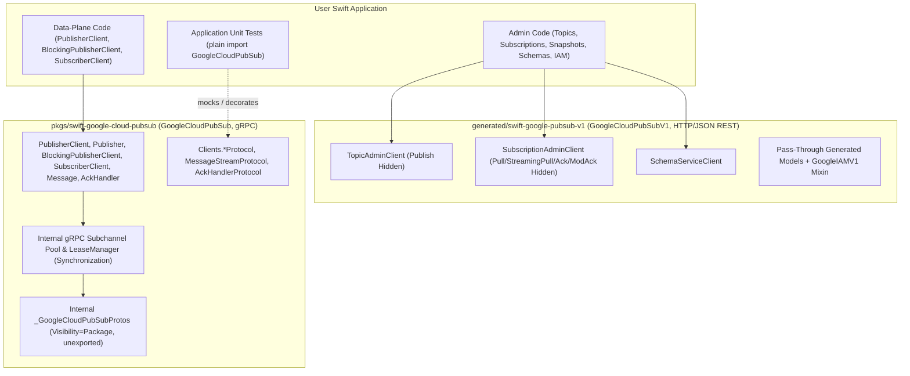
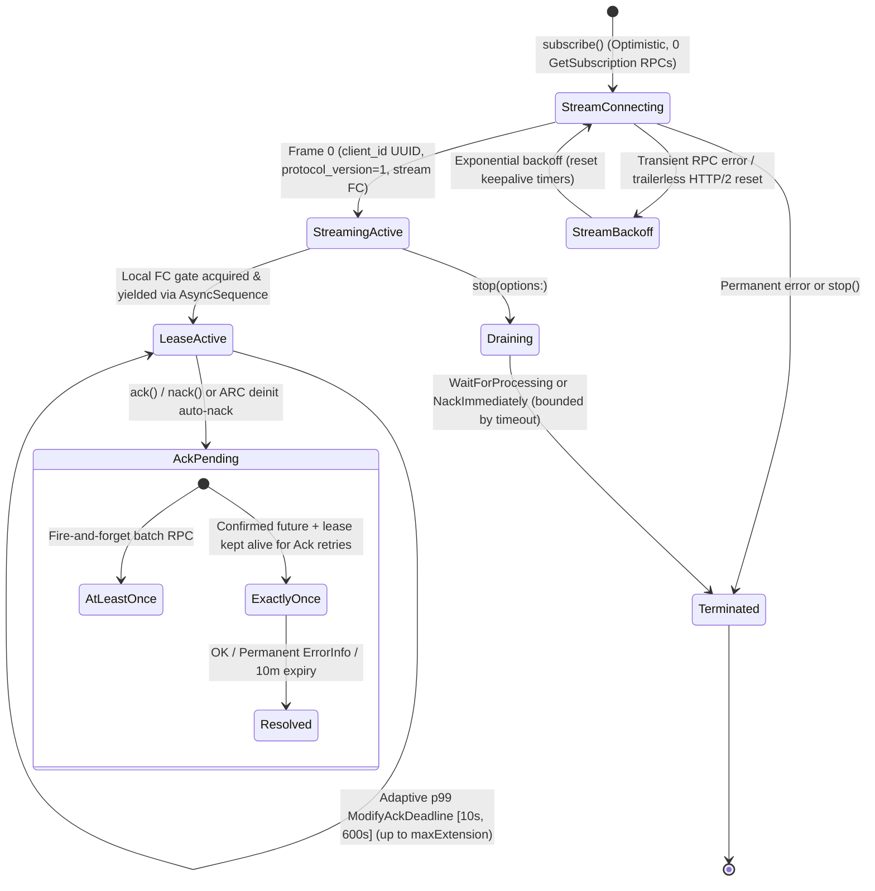

# GoogleCloudPubSub: Swift Client Library Specification (Spec v2.1)

> [!IMPORTANT]
> - **Normative Baseline:** Refines the Language-Agnostic Cloud Pub/Sub Client Library Specification (v2.1), [ARCHITECTURE.md](../../ARCHITECTURE.md), and [Designing Hand-written Client APIs](../contributor/howto-guide-handwritten-client-api.md) (`E1`–`E10`, `K1`–`K4`, `O1`–`O4`, `I1`–`I7`, `T1`–`T8`, `Doc1`–`Doc7`) onto idiomatic **Swift 6**.
> - **Architecture Split:** Separates the generated HTTP/JSON Admin GAPIC package (`generated/swift-google-pubsub-v1` / `GoogleCloudPubSubV1`, hiding all 5 data-plane RPCs) from the zero-dependency handwritten gRPC Data-Plane Veneer (`pkgs/swift-google-cloud-pubsub` / `GoogleCloudPubSub`).
> - **Tier 1 + Tier 2/3 Scope (`v0.x`):** Ships full Tier 1 (`Publisher`, `Subscriber`, EOD, keepalive, emulator, mocks, benchmarks, samples, `PubSubConformanceProxy`), Tier 2 Publisher/Subscriber flow control, request hedging, and `gzip` compression, plus Tier 3 `BlockingPublisherClient`, managed unary `pull`, and adaptive p99 ack-extension histogram. Defers OpenTelemetry tracing & CLO v1 metrics (`supports_monitoring = false`) to the repo-wide `GoogleGax` OpenTelemetry pre-`1.0` GA milestone.

---

## 1. Purpose, Scope & Decision Checklist

This document defines the normative Swift 6 public API, behavioral invariants, package boundaries, observability strategy, conformance proxy mapping, performance targets, testing matrix, and sample catalog for Google Cloud Pub/Sub (`google.pubsub.v1`) in `google-cloud-swift`.

All new packages compile under **Swift 6** (`swift-tools-version: 6.2`) with:
- `.enableUpcomingFeature("ExistentialAny")`
- `.enableUpcomingFeature("InternalImportsByDefault")`
- `.enableUpcomingFeature("MemberImportVisibility")`
- `.enableUpcomingFeature("NonisolatedNonsendingByDefault")`
- `.strictMemorySafety()`
- `-warnings-as-errors` in CI.

### 1.1 Per-Language Design Doc Decision Checklist (Spec §1.2)

| Decision Area | Swift Decision (`GoogleCloudPubSub` & `GoogleCloudPubSubV1`) | Rationale & Reference |
| :--- | :--- | :--- |
| **Package & Module Names** | • **Admin GAPIC:** `generated/swift-google-pubsub-v1` (module `GoogleCloudPubSubV1`, HTTP/JSON REST via `GoogleGax._HTTPClient`)<br>• **Data-Plane Veneer:** `pkgs/swift-google-cloud-pubsub` (module `GoogleCloudPubSub`, gRPC via `GoogleGaxGRPC` / `grpc-swift-2`)<br>• **Zero runtime/build dependency** in either direction | Spec §2.1, `librarian.yaml` |
| **Delivery & Ordering Idioms** | • **Pull-based `AsyncSequence` only** (`SubscriberClient.subscribe` → `any MessageStreamProtocol`, `supports_subscriber_ordering = false`)<br>• **Auto-nack on ARC `deinit`** when unsettled (`supports_auto_nack_on_drop = true`)<br>• **Auto-ordering on non-empty `orderingKey`** (`supports_ordering_opt_in = false`, matching rule `I6`) | Spec §1.2, §5.3, §6.3–§6.4; Rule `I6` |
| **Phase 2 GA Deferral Plan** | • **Included in `v0.x`:** Publisher & per-stream Subscriber flow control (with local admission gating), publish request hedging, and publish `gzip` payload compression<br>• **Deferred to pre-`1.0` GA milestone:** OpenTelemetry traces (`TRAC-01`–`TRAC-04`) and CLO v1 metrics/logs (`T4`–`T6`, `M3`/`M4`, `L3`/`L4`), gated behind `supports_monitoring = false`; `v0.x` emits `swift-log` telemetry (`O1`–`O4`) | Spec §1.1, §8; `GoogleGax` OTel alignment |
| **Tier 3 Optional Decisions** | • **Adopted:** EOD pre-yield receipt modack gating (`EOD-04`), Veneer unary `pull` with automatic lease management (`SubscriberClient.pull`), `BlockingPublisherClient` (unbatched unary publish), and **adaptive p99 ack-latency lease extension histogram**<br>• **Omitted:** `forget()` / imperative `modifyAckDeadline(seconds)`, lightweight `SchemaMetadata` helpers, public `pstest`-style fake server product (kept internal for tests/benchmarks), locational endpoint helper, and the 8 optional Ingestion/UDF-SMT Admin samples | Spec §1.2, §4, §5.8, §6.7, §7.3, §11.2 |
| **Mocking Surface** | • Under `public enum Clients`: `Clients.PublisherClientProtocol`, `Clients.PublisherProtocol`, `Clients.BlockingPublisherProtocol`, `Clients.SubscriberProtocol`, plus top-level `MessageStreamProtocol` and `AckHandlerProtocol`<br>• Every RPC/action requirement has a default `RequestError.unimplemented` extension (`K1`), returns a named struct (`E1`), ends with an operation-specific options struct (`E2`), and can be mocked/decorated with plain `import GoogleCloudPubSub` (`K2`, `T2`)<br>• Admin GAPIC auto-generates `Clients.TopicAdminProtocol`, `Clients.SubscriptionAdminProtocol`, and `Clients.SchemaServiceProtocol` | Spec §7; Rules `E1`, `E2`, `K1`, `K2`, `T2` |
| **Observability Bridging** | • `v0.x`: Constructor-injected `Logging.Logger?` via `GoogleGax.ClientOptions.logger`, matching generated `<Service>+Logging` keys (`gcp.artifact.id = "google-cloud-pubsub"`, `gcp.client.service = "pubsub"`, real `rpc.method` values, single terminal boundary error logging per `O1`–`O4`)<br>• Pre-`1.0` GA: `TracerProvider` / `MeterProvider` options + `GOOGLE_CLOUD_<SIGNAL>_ENABLED` precedence (`C1`–`C5`), plus `ReceivedMessage.withProcessingSpan(_:)` for active `{sub} process` span context (`TRAC-03`–`TRAC-04`) | Rules `O1`–`O4`; Spec §8 |
| **Throughput & Runtime Scaling** | • Native compiled Swift 6 on Swift cooperative thread pool + `grpc-swift-2` (no GIL / single-thread bottleneck)<br>• Multi-channel gRPC pool (`subchannelCount`, default `min(max(activeProcessorCount, 1), 4)`) + shared lease loop across streams<br>• Targets full `>= 80%` Go/Rust `c2-standard-16` parity bars and `<= 5%` loopback stub overhead via `PubSubThroughput` / `PubSubThroughputBenchmark` in root `Package.swift` | Spec §10, Appendix D.1 |
| **Sample & Docstring Harness** | • Swift-DocC `@Snippet(path:)` backed by `Snippets/*.swift` in both packages + inline examples (`Doc1`–`Doc7`), validated with `-warnings-as-errors` and DocC builds<br>• `~67` canonical DevSite `[START pubsub_*]` samples (`65` core less 2 deferred OTel tags until GA + `2` `pubsub_subscriber_sync_pull*` tags) in `Sources/PubSubSamples` + `Tests/PubSubSamplesDriver` in root `Package.swift` | Spec §11; Rules `Doc1`–`Doc7`; `write-devrel-sample` |

### 1.2 `PubSubProxy` Capabilities & `ClientDefaults` Mapping

The conformance proxy standalone package (`conformance/PubSubConformanceProxy`) drives the unmodified public `GoogleCloudPubSub` API and reports the following exact `GetCapabilitiesResponse` fields (`schema/pubsub/conformance/v1/proxy.proto`):

#### Capability Flags (`18` Booleans)

| Field (`GetCapabilitiesResponse`) | Value | Swift Backing & Notes |
| :--- | :---: | :--- |
| `supports_monitoring` | `false` | OTel traces / CLO v1 deferred to pre-`1.0` GA milestone (`4/4` trace-only scenarios record `SKIPPED_NO_MONITORING`; `TRAC-03` W3C passthrough does not fail delivery) |
| `supports_unary_pull` | `true` | `SubscriberClient.pull(subscription:options:)` with managed leases |
| `supports_blocking_publish` | `true` | `BlockingPublisherClient.publish(_:topic:options:)` |
| `supports_publish_flow_control` | `true` | `PublisherFlowControlOptions` (`ignore`, `block`, `signalError`) |
| `supports_publish_compression` | `true` | `CompressionOptions` (`gzip` payload compression above `240` bytes) |
| `supports_publish_hedging` | `true` | `HedgingOptions` (milli-token bucket + `x-goog-pubsub-client-telemetry`) |
| `supports_ordering_opt_in` | `false` | Auto-ordering whenever `message.orderingKey` is non-empty |
| `supports_subscriber_ordering` | `false` | Pull-based `AsyncSequence` yields sequentially |
| `supports_keepalive` | `true` | `protocol_version = 1` empty keepalive pings (`30s`) & `15s` pong timeout |
| `supports_eod_receipt_modack` | `true` | Pre-yield EOD receipt `ModifyAckDeadline` gating with `ErrorInfo` splitting (`EOD-04`) |
| `supports_auto_nack_on_drop` | `true` | Unsettled `ReceivedMessage` triggers automatic `nack` on ARC `deinit` |
| `supports_ack_with_result` | `true` | `ReceivedMessage.ackWithResult(options:)` / `nackWithResult(options:)` |
| `supports_custom_retry_codes` | `true` | `GoogleGax.RetryPolicy` via `GoogleGax.RequestOptions.retryPolicy` |
| `supports_exactly_once_delivery` | `true` | Dynamic per-batch `subscription_properties.exactly_once_delivery_enabled` + `ErrorInfo` splitting |
| `supports_per_stream_flow_control` | `true` | Per-stream `maxOutstandingMessages` / `maxOutstandingBytes` + local admission gate |
| `supports_resume_publish` | `true` | `Publisher.resumePublishing(orderingKey:options:)` |
| `supports_shutdown_behavior` | `true` | `ShutdownBehavior.waitForProcessing` & `.nackImmediately` |
| `supports_shutdown_timeout` | `true` | `SubscriberShutdownOptions.timeout` (`nil` = unbounded, `.zero` = immediate) |

#### Default Values (`27` `ClientDefaults` Fields)

| Category | Proto Field (`ClientDefaults`) | Swift Default Value |
| :--- | :--- | :--- |
| **Publisher** | `publish_batch_count_threshold` | `100` |
| | `publish_batch_byte_threshold` | `1_000_000` (`1 MB`) |
| | `publish_max_request_bytes` | `10_000_000` (`10 MB`) |
| | `publish_batch_delay_ms` | `10` (`.milliseconds(10)`) |
| | `publish_total_timeout_ms` | `600_000` (`.seconds(600)`) |
| | `publish_flow_control_max_messages` | `-1` (`nil` / unlimited) |
| | `publish_flow_control_max_bytes` | `-1` (`nil` / unlimited) |
| | `publish_flow_control_behavior` | `FLOW_CONTROL_LIMIT_BEHAVIOR_IGNORE` |
| | `publish_compression_enabled_by_default` | `false` |
| | `publish_compression_bytes_threshold` | `240` |
| | `publish_compression_algorithm` | `COMPRESSION_ALGORITHM_GZIP` |
| | `publish_hedging_delay_ms` | `1_000` (`.seconds(1)`) |
| | `publish_hedging_max_tokens` | `50` |
| | `publish_hedging_refill_ratio` | `0.1` |
| **Subscriber** | `subscriber_max_outstanding_messages` | `1_000` (per stream) |
| | `subscriber_max_outstanding_bytes` | `104_857_600` (`100 MiB` per stream) |
| | `subscriber_max_extension_ms` | `3_600_000` (`.seconds(3_600)`) |
| | `subscriber_min_ack_extension_ms` | `10_000` (`.seconds(10)`, dynamically `.seconds(60)` on EOD unless overridden) |
| | `subscriber_max_ack_extension_ms` | `600_000` (`.seconds(600)`) |
| | `subscriber_adaptive_ack_extension` | `true` |
| | `subscriber_per_stream_flow_control` | `true` |
| | `subscriber_default_stream_ack_deadline_seconds` | `60` |
| | `keepalive_ping_interval_ms` | `30_000` (`.seconds(30)`) |
| | `keepalive_pong_timeout_ms` | `15_000` (`.seconds(15)`) |
| **Retry** | `retry_initial_delay_ms` | `100` (`.milliseconds(100)`) |
| | `retry_max_delay_ms` | `60_000` (`.seconds(60)`) |
| | `retry_delay_multiplier` | `1.3` |

---

## 2. Two-Package Architecture & Zero-Dependency Split

Consistent with Spec §2.1, control-plane resource administration and data-plane streaming/batching reside in two completely decoupled Swift packages with **zero build or runtime dependency** in either direction:



### 2.1 Admin GAPIC Package (`generated/swift-google-pubsub-v1`)

1. **Generation Configuration (`librarian.yaml`):**
   - Library entry: `google-pubsub-v1` (matching API path `google/pubsub/v1`), outputting to `generated/swift-google-pubsub-v1` with Swift module/product name `GoogleCloudPubSubV1` (`library_name_override: GoogleCloudPubSubV1`).
   - Transport: HTTP/JSON REST (`GoogleGax._HTTPClient`), matching `google-cloud-swift` generated library standards (`ARCHITECTURE.md`).
   - `name_overrides`:
     - `.google.pubsub.v1.Publisher: TopicAdmin` → generates `TopicAdminClient` & `Clients.TopicAdminProtocol`
     - `.google.pubsub.v1.Subscriber: SubscriptionAdmin` → generates `SubscriptionAdminClient` & `Clients.SubscriptionAdminProtocol`
     - `SchemaService` remains `SchemaServiceClient` & `Clients.SchemaServiceProtocol`
   - `quickstart_service_override: TopicAdmin`
   - `emulator_environment_variable: PUBSUB_EMULATOR_HOST`
   - **`skipped_ids` (All 5 Data-Plane RPCs + 11 Unreferenced Data-Plane Wire Messages Hidden for Co-Import Compatibility):**
     ```yaml
     skipped_ids:
       - .google.pubsub.v1.Publisher.Publish
       - .google.pubsub.v1.Subscriber.Pull
       - .google.pubsub.v1.Subscriber.StreamingPull
       - .google.pubsub.v1.Subscriber.Acknowledge
       - .google.pubsub.v1.Subscriber.ModifyAckDeadline
       - .google.pubsub.v1.PublishRequest
       - .google.pubsub.v1.PublishResponse
       - .google.pubsub.v1.PubsubMessage
       - .google.pubsub.v1.PullRequest
       - .google.pubsub.v1.PullResponse
       - .google.pubsub.v1.ReceivedMessage
       - .google.pubsub.v1.ModifyAckDeadlineRequest
       - .google.pubsub.v1.AcknowledgeRequest
       - .google.pubsub.v1.StreamingPullRequest
       - .google.pubsub.v1.StreamingPullResponse
       - .google.pubsub.v1.PubsubClientTelemetry
     ```
2. **Exposed Services & Pass-Through Models:**
   - **`TopicAdminClient`:** `createTopic`, `updateTopic`, `getTopic`, `listTopics` (`listTopicsByItems`), `listTopicSubscriptions` (`listTopicSubscriptionsByItems`), `listTopicSnapshots` (`listTopicSnapshotsByItems`), `deleteTopic`, `detachSubscription`, plus `GoogleIAMV1` operations (`setIamPolicy`, `getIamPolicy`, `testIamPermissions`).
   - **`SubscriptionAdminClient`:** `createSubscription`, `getSubscription`, `updateSubscription`, `listSubscriptions` (`listSubscriptionsByItems`), `deleteSubscription`, `modifyPushConfig`, `createSnapshot`, `getSnapshot`, `updateSnapshot`, `listSnapshots` (`listSnapshotsByItems`), `deleteSnapshot`, `seek`, plus `GoogleIAMV1` operations.
   - **`SchemaServiceClient`:** `createSchema`, `getSchema`, `listSchemas` (`listSchemasByItems`), `listSchemaRevisions` (`listSchemaRevisionsByItems`), `commitSchema`, `rollbackSchema`, `deleteSchemaRevision`, `deleteSchema`, `validateSchema`, `validateMessage`, plus `GoogleIAMV1` operations if present in the service config.
   - All proto models (`Topic`, `Subscription`, `Snapshot`, `Schema`, `BigQueryConfig`, `BigtableConfig`, `CloudStorageConfig`, `IngestionDataSourceSettings`, `MessageTransform`, `DeadLetterPolicy`, `RetryPolicy`, `ExpirationPolicy`, `MessageStoragePolicy`, `tags`) are exposed directly with zero OOP wrapper classes.
   - **Invariant:** `generated/swift-google-pubsub-v1` is strictly managed by `librarian generate` and **never manually edited**.

### 2.2 Data-Plane Veneer Package (`pkgs/swift-google-cloud-pubsub`)

1. **Manifest & Targets:**
   - Package directory: `pkgs/swift-google-cloud-pubsub`
   - Public library product: `GoogleCloudPubSub` (zero dependency on `GoogleCloudPubSubV1`).
   - Internal unexported target: `_GoogleCloudPubSubProtos` (generated via `librarian.yaml` module `module_type: swift-protobuf`, `api_path: google/pubsub/v1`, `visibility: package` (`--swift_out=Visibility=Package`) into `pkgs/swift-google-cloud-pubsub/Sources/generated/_GoogleCloudPubSubProtos`, plus `package-version` module into `pkgs/swift-google-cloud-pubsub/Sources/GoogleCloudPubSub/generated/version`). Using package visibility and the package-prefixed `_GoogleCloudPubSubProtos` name prevents SwiftPM target-name collisions and global symbol leakage when downstream apps also generate or depend on Pub/Sub protos (`T8`).
   - Runtime dependencies: `GoogleAuth`, `GoogleGax`, `GoogleGaxGRPC`, `GoogleWKT`, `GoogleWKTConvert`, `GoogleRpc`, `Logging`, `GRPCCore`, `GRPCNIOTransportHTTP2Posix`, `GRPCProtobuf`, `SwiftProtobuf`, and `DequeModule` (`swift-collections`), using `grpc-swift-2` native `.gzip` compression and Swift 6 `import Synchronization` (`Mutex` / `Atomic`) for synchronization (zero direct `swift-nio` / `NIOConcurrencyHelpers` dependency).
   - Only `GoogleCloudPubSub` is exported in `products:`; `_GoogleCloudPubSubProtos` is `package`-scoped and unexported, never appearing in any public API signature (`import _GoogleCloudPubSubProtos` under `InternalImportsByDefault`).
   - Root `Package.swift` adds `PubSubSamples` + `PubSubSamplesDriver` (which depend on **both** `GoogleCloudPubSub` and `GoogleCloudPubSubV1` for end-to-end sample execution and co-linking/co-import verification `PubSubCoLinkTests`), `PubSubThroughput` + `PubSubThroughputBenchmark`, and `PubSubThroughputTests`; standalone packages under `benchmarks/pubsub-local-benchmark` and `conformance/PubSubConformanceProxy` isolate loopback benchmarks and conformance protos from the root package dependency graph.

---

## 3. Transport, Multi-Channel Pooling, Headers & Emulator

### 3.1 Multi-Channel gRPC Pool & Frame Limits

A single HTTP/2 connection saturates around `~150 MB/s` and 100 concurrent streams. `GoogleCloudPubSub` maintains an internal `GRPCChannelPool` actor/class (`Sendable`) managing `subchannelCount` independent HTTP/2 `GRPCClient<HTTP2ClientTransport.Posix>` connections (`grpc-swift-2`):

- **`subchannelCount: Int`:** Defaults to `min(max(ProcessInfo.processInfo.activeProcessorCount, 1), 4)`. Callers may override via `PublisherClientOptions.subchannelCount`, `BlockingPublisherClientOptions.subchannelCount`, or `SubscriberClientOptions.subchannelCount`. Values `< 1` throw `PubSubError.invalidConfiguration` on client initialization (`E3`/`E4`).
- **Round-Robin Scheduling:**
  - Unary `Publish`, `Pull`, `Acknowledge`, and `ModifyAckDeadline` calls select the next channel atomically via an atomic round-robin counter.
  - `StreamingPull` streams (`streamCount` streams in `SubscriberClient.subscribe`) assign stream `i` to channel `i % subchannelCount` so concurrent streams spread evenly across HTTP/2 connections.
- **gRPC Frame & Metadata Limits:**
  - Configure `HTTP2ClientTransport.Posix.Config` (and `GRPCCore` service config / max message size) with **`maxInboundMessageBytes` >= `20 MiB` (`20 * 1024 * 1024`)** (accommodating `10 MB` payloads + protobuf framing overhead) and **`maxInboundMetadataBytes` >= `4 MiB` (`4 * 1024 * 1024`)** (for large `ErrorInfo` payloads).
- **Shared Connection Lifecycle:** Creating multiple topic-scoped `Publisher` instances via `PublisherClient.publisher(topic:options:)` shares the parent `PublisherClient`'s `GRPCChannelPool`, `Credentials`, and `AdaptiveThrottler`. Calling `PublisherClient.shutdown(options:)` gracefully closes the shared pool after awaiting or cancelling outstanding work.

### 3.2 Resource Names & Routing Invariants (`CFG-03`, `CFG-04`)

1. **Canonical Resource Paths (`CFG-04`):**
   - When `topic` or `subscription` matches a canonical 4-segment path (`projects/{project}/topics/{topic}` or `projects/{project}/subscriptions/{subscription}`), it is transmitted **verbatim** on the wire (`PublishRequest.topic`, `StreamingPullRequest.subscription`, `PullRequest.subscription`, `AcknowledgeRequest.subscription`, `ModifyAckDeadlineRequest.subscription`) and in `x-goog-request-params`. A client-level `projectID` **never** overwrites `{project}` in an already-qualified 4-segment path.
2. **Short Resource ID Resolution (`CFG-03`):**
   - If a client configures `projectID` (`PublisherClientOptions.projectID`, `BlockingPublisherClientOptions.projectID`, `SubscriberClientOptions.projectID`), callers may pass a short resource ID (`"my-topic"` / `"my-sub"`, containing no `"/"`), which expands to `"projects/\(projectID)/topics/\(shortID)"` or `"projects/\(projectID)/subscriptions/\(shortID)"`.
   - If a short ID is passed when `projectID` is `nil` or empty (`""`), operations **fail locally with zero wire RPCs**, throwing `PubSubError.emptyProjectID(resource: topicOrSubscription)`.
   - Unqualified multi-segment paths that are neither short IDs nor `projects/.../...` are sent as provided unless empty, deferring policy validation to the server (`E3`).

### 3.3 Mandatory Wire Metadata Headers (`CFG-02`)

Every outgoing gRPC call — `Publish`, `Pull`, `StreamingPull` (initial connection **and** every reconnect), `Acknowledge`, and `ModifyAckDeadline` — MUST attach:

| Header Key | Value Format & Source | Invariant |
| :--- | :--- | :--- |
| `x-goog-request-params` | `topic=<percent-encoded>` (Publish) or `subscription=<percent-encoded>` (Pull / StreamingPull / Ack / ModAck) | Preserved on **all** RPCs including reconnects and unary settlements (`CFG-02`) |
| `x-goog-api-client` | `GoogleGax._ApiClientHeader.veneer(packageVersion: PackageVersion.version)` + `grpc/2.4.4` + `pb/<SwiftProtobuf.Version.versionString>` | Dynamically derives veneer & protobuf versions; pins gRPC token to resolved `grpc-swift-2` version |
| `x-goog-user-project` | Effective `request.quotaProject ?? client.quotaProject` (omitted if `nil`) | Per-request overrides client-level & credential-level quota project |
| `x-goog-pubsub-client-telemetry` | Base64-encoded serialized `Google_Pubsub_V1_PubsubClientTelemetry` | Sent when publish hedging is enabled (`HDG-03`) |
| Custom `HTTPHeaders` | Sanitized merge of `clientOptions.headers` (if added via `RequestOptions`) + operation `options.request.headers` | Preserved on **every** RPC including stream reconnects and background `Acknowledge` / `ModifyAckDeadline` (`CFG-02`); system & auth headers remain protected via `GoogleGax._sanitizeCustomHeaders` |

### 3.4 Endpoints, Universe Domain & `PUBSUB_EMULATOR_HOST` (`CFG-01`)

- **Default Endpoint & Universe Domain:** Default endpoint is `"https://pubsub.googleapis.com"`. Uses `GoogleGax._Host.resolveUniverseDomain(options:environment:)` (`options.universeDomain` > `GOOGLE_CLOUD_UNIVERSE_DOMAIN` > `"googleapis.com"`) and validates credential universe domain consistency via `credentials.validateUniverseDomain(...)`. Supports custom, regional (`pubsub.us-central1.rep.googleapis.com`), locational (`us-east1-pubsub.googleapis.com`), and Private Service Connect (`private.googleapis.com`) endpoints.
- **Automatic `PUBSUB_EMULATOR_HOST` Support (`CFG-01`, Service-Agnostic GAX Hook):**
  - `GoogleGax` and `GoogleGaxGRPC` remain strictly service-agnostic: `_Host.resolveEmulatorEndpoint(endpoint:emulatorEnvironmentVariable:environment:)`, `_HTTPClient.init(..., emulatorEnvironmentVariable:)`, and `_GRPCClient.init(..., emulatorEnvironmentVariable:)` accept an optional caller-supplied environment variable name (`String? = nil`).
  - Both `GoogleCloudPubSub` (`GRPCChannelPool`) and generated `GoogleCloudPubSubV1` (`librarian.yaml` `emulator_environment_variable: PUBSUB_EMULATOR_HOST`) pass `emulatorEnvironmentVariable: "PUBSUB_EMULATOR_HOST"` into GAX:
    - When `PUBSUB_EMULATOR_HOST` is non-empty (e.g., `"localhost:8085"` or `"http://127.0.0.1:8085"`):
      1. **Endpoint Precedence:** Explicit `ClientOptions.endpoint` > `PUBSUB_EMULATOR_HOST` (normalized to plaintext `http://<host:port>`) > universe-domain default endpoint (`https://pubsub.<universe>`).
      2. **Plaintext Transport:** Automatically disables TLS (`http://` / `HTTP2ClientTransport.Posix.TransportSecurity.plaintext`).
      3. **Credential Precedence:** Explicit `ClientOptions.credentials` > `Credentials(configuration: .anonymous)` (bypassing ADC file/MDS resolution when `PUBSUB_EMULATOR_HOST` is active) > `Credentials()` (`.adc()`).
    - **Admin GAPIC note:** `librarian` emits `emulatorEnvironmentVariable: "PUBSUB_EMULATOR_HOST"` into `TopicAdmin`, `SubscriptionAdmin`, and `SchemaService` transport initializers when `emulator_environment_variable: PUBSUB_EMULATOR_HOST` is configured in `librarian.yaml`, so both Admin and Data-Plane clients work against the emulator out of the box with zero manual edits to `generated/`.

---

## 4. Public Data Model, Errors & API Surface (`GoogleCloudPubSub`)

All public types conform to `Sendable` and follow Rules `E1`–`E10`, `K1`–`K4`, and `I1`–`I7` from `howto-guide-handwritten-client-api.md` (no tuples on requirements, operation-specific options structs, no `Codable` unless canonical ProtoJSON, no client-side validation of mutable service quotas, uniform acronym casing `projectID`, `messageID`, `ackID`, `clientID`, `Int` for counts/sizes/limits, `var` + `init()` + `.with(_:)`).

### 4.1 Core Data Model (`Message`)

```swift
/// A Google Cloud Pub/Sub message for publishing or received from a subscription.
///
/// Use ``Message`` both to construct outbound messages for ``Publisher`` / ``BlockingPublisherClient``
/// and to inspect payload and metadata on a ``ReceivedMessage``.
public struct Message: Sendable, Hashable {
  /// The opaque message payload bytes. Empty `Data()` is permitted per the Pub/Sub protobuf schema.
  public var data: Data = Data()

  /// Application-defined string key-value attributes.
  ///
  /// Keys prefixed with `googclient_` are reserved by Google Cloud client libraries.
  /// Publishing never mutates the caller's dictionary in place (`TRAC-01`).
  public var attributes: [String: String] = [:]

  /// Optional ordering key. An empty string (`""`) denotes an unordered message.
  public var orderingKey: String = ""

  /// Server-assigned unique message ID (populated on received messages).
  public var messageID: String = ""

  /// Server timestamp when the message was published (populated on received messages).
  public var publishTime: GoogleWKT.WKTTimestamp? = nil

  /// Approximate 1-based delivery attempt count when a dead-letter policy is enabled (`nil` otherwise).
  public var deliveryAttempt: Int? = nil

  /// Creates an empty message.
  public init() {}

  /// Creates a message with payload data, optional attributes, and optional ordering key.
  public init(
    data: Data = Data(),
    attributes: [String: String] = [:],
    orderingKey: String = ""
  ) {
    self.data = data
    self.attributes = attributes
    self.orderingKey = orderingKey
  }

  /// Creates a modified copy using closure configuration.
  @inlinable
  public func with(_ config: (inout Self) throws -> Void) rethrows -> Self {
    var copy = self
    try config(&copy)
    return copy
  }
}
```

- **No `Codable` (`E5`):** `Message` intentionally does not conform to `Codable`.
- **Wire Size Estimation:** Internal `estimatedWireByteSize()` calculates exact encoded `PubsubMessage` size (`data` tag + length varint + payload bytes + attributes entries + orderingKey bytes) consistently across batching (`10,000,000` bytes cap), publisher flow control, and subscriber flow control.
- **No Mutable Service Quota Checks (`E3`):** Empty payloads (`Data()`), attribute count, and attribute lengths are not rejected locally. Only wire invariants are enforced: single message `> 10,000,000` encoded bytes (`PUB-06b`) and non-UTF-8 keys/values if constructed from raw bytes via internal/proxy paths (`PUB-02`).

### 4.2 Settlement Types & Error Contract (`E8`, `E10`)

```swift
/// The terminal settlement outcome for an acknowledgment or negative acknowledgment.
///
/// - Note: Future releases may promote values out of ``other(_:)`` into dedicated cases.
///   Do not match specific strings in `.other(_:)`; always include `@unknown default:` when switching.
public enum SettlementStatus: Sendable, Hashable {
  /// The settlement succeeded (or mapped from fire-and-forget at-least-once RPC success).
  case success
  /// The caller lacks permission (`pubsub.subscriptions.consume`) to settle the message.
  case permissionDenied
  /// The subscription's precondition prevented settlement (e.g., detached or mismatched state).
  case failedPrecondition
  /// The acknowledgment ID is invalid or expired (past the 10-minute server ack-ID TTL).
  case invalidAckID
  /// An unrecognized permanent failure reason returned by the server.
  case other(String)
}

/// Detailed failure metadata for a confirmed exactly-once settlement (`ackWithResult` / `nackWithResult`).
public struct AckError: Error, Sendable, CustomStringConvertible, CustomDebugStringConvertible {
  public var status: SettlementStatus
  public var message: String
  public var underlyingError: GoogleGax.RequestError?

  public init(
    status: SettlementStatus,
    message: String,
    underlyingError: GoogleGax.RequestError? = nil
  )
}

/// The result returned by ``AckHandlerProtocol/ackWithResult(options:)`` or
/// ``AckHandlerProtocol/nackWithResult(options:)``.
public struct AckResult: Sendable, Equatable {
  public var status: SettlementStatus

  public init(status: SettlementStatus = .success)
}

/// Reason a local publish flow-control limit was exceeded.
public enum FlowControlLimitReason: Sendable, Equatable {
  case messageCount(pending: Int, limit: Int)
  case byteCount(pendingBytes: Int, limitBytes: Int)
}

/// Client-detected errors thrown by `GoogleCloudPubSub`.
///
/// ### Error Contract (`E8`)
/// - **Service & Transport Failures:** Network, authentication, gRPC status, and exhausted retry-loop
///   errors from `Publish`, `Pull`, `StreamingPull`, `Acknowledge`, and `ModifyAckDeadline` are
///   thrown as `GoogleGax.RequestError` (`.service`, `.io`, `.exhausted`, `.badURL`, `.unimplemented`).
/// - **Client-Detected & Lifecycle Failures:** Local structural invariant violations, shutdown states,
///   corked ordering keys, and confirmed settlement failures throw ``PubSubError``.
///
/// - Note: New cases may be added in minor releases; always include `@unknown default:` when switching.
public enum PubSubError: Error, Sendable, CustomStringConvertible, CustomDebugStringConvertible {
  /// The publisher (or parent `PublisherClient`) has already been shut down.
  case publisherShutDown
  /// The message's ordering key is paused due to an earlier permanent batch failure.
  case orderingKeyPaused(orderingKey: String)
  /// A single message exceeds the `10,000,000`-byte (`10 MB`) `PublishRequest` limit (`PUB-06b`).
  case messageTooLarge(sizeBytes: Int, limitBytes: Int)
  /// Message attribute keys or values are not valid UTF-8 (`PUB-02`).
  case invalidUTF8Attribute(description: String)
  /// Local flow-control watermarks were exceeded with `.signalError` behavior (`PFC-03`).
  case flowControlLimitExceeded(FlowControlLimitReason)
  /// A short resource ID was passed without a configured `projectID` (`CFG-03`).
  case emptyProjectID(resource: String)
  /// Server `PublishResponse.message_ids` count mismatched request `messages` count (`PUB-10`).
  case mismatchedMessageIDCount(expected: Int, received: Int)
  /// Confirmed exactly-once settlement (`ackWithResult` / `nackWithResult`) failed (`EOD-02`, `EOD-03`).
  case settlementFailed(AckError)
  /// Invalid publisher or subscriber configuration (for example, out-of-range hedging bounds).
  case invalidConfiguration(description: String)
}
```

### 4.3 Named Return Structs & Opaque `PublishHandle` (`E1`, `E7`)

Every protocol requirement returns a named struct so future metadata additions are non-breaking (`E1`):

```swift
/// Result of publishing a single message.
public struct PublishResult: Sendable, Equatable {
  public var messageID: String
  public init(messageID: String = "")
}

/// Acknowledgement handle returned when scheduling a fire-and-forget ack.
public struct AckQueuedResult: Sendable, Equatable {
  public init() {}
}

/// Acknowledgement handle returned when scheduling a fire-and-forget nack.
public struct NackQueuedResult: Sendable, Equatable {
  public init() {}
}

/// Result of flushing buffered batches on a ``Publisher``.
public struct FlushResult: Sendable, Equatable {
  public init() {}
}

/// Result of resuming a paused ordering key.
public struct ResumePublishingResult: Sendable, Equatable {
  public init() {}
}

/// Result of shutting down a publisher, publisher client, or subscriber stream.
public struct ShutdownResult: Sendable, Equatable {
  public init() {}
}

/// Result of a managed unary pull (`SubscriberClient.pull`).
public struct PullResult: Sendable {
  public var messages: [ReceivedMessage]
  public init(messages: [ReceivedMessage] = [])
}

/// An opaque handle representing an enqueued, in-flight publish operation (`E7`).
///
/// Dropping or ignoring `PublishHandle` never cancels transmission of the accepted message.
public struct PublishHandle: Sendable {
  /// Awaits the server-assigned message ID or throws if the publish batch fails permanently.
  public func result() async throws -> PublishResult

  /// Creates a pre-resolved handle for unit tests and mock implementations.
  public init(resolvedResult: Result<PublishResult, any Error>)

  /// Creates a handle backed by a custom async resolver for unit tests and forwarding decorators.
  public init(resolver: @escaping @Sendable () async throws -> PublishResult)
}
```

### 4.4 Operation-Specific Single-Level Options (`E2`, `E6`, `I5`, `I7`)

Every options struct has `var` properties, a parameterless `init()`, `.with(_:)`, and at most one `RequestOptions` field (`I5`):

- **Publisher Client & Topic Options:**
  - `PublisherClientOptions`: `client: GoogleGax.ClientOptions = .init()`, `projectID: String? = nil`, `subchannelCount: Int = defaultSubchannelCount()`, `defaultTopicOptions: TopicPublisherOptions = .init()`
  - `BatchingOptions`: `countThreshold: Int = 100` (`>= 1`, upper-clamped at `1_000`), `byteThreshold: Int = 1_000_000` (`>= 1`, upper-clamped at `10_000_000`; `< 1` throws `PubSubError.invalidConfiguration`), `delayThreshold: Duration = .milliseconds(10)`
  - `FlowControlLimitExceededBehavior`: `.ignore` (default), `.block`, `.signalError`
  - `PublisherFlowControlOptions`: `maxPendingMessages: Int? = nil`, `maxPendingBytes: Int? = nil`, `limitExceededBehavior: FlowControlLimitExceededBehavior = .ignore`
  - `CompressionOptions`: `isEnabled: Bool = false`, `bytesThreshold: Int = 240`
  - `HedgingOptions`: `isEnabled: Bool = false`, `delay: Duration = .seconds(1)` (validated `[.milliseconds(100), .seconds(10)]`), `maxTokens: Int = 50` (validated `1...250`), `refillRatio: Double = 0.1` (validated `0.001...0.2`; throws `PubSubError.invalidConfiguration` when enabled and out of range)
  - `TopicPublisherOptions`: `batching: BatchingOptions = .init()`, `flowControl: PublisherFlowControlOptions = .init()`, `compression: CompressionOptions = .init()`, `hedging: HedgingOptions = .init()`, `request: GoogleGax.RequestOptions = .init()` (inherits `PubSubRetryPolicy.defaultPublishPolicy` when `request.retryPolicy == nil`)
  - Operation-specific structs: `PublishOptions` (`request: GoogleGax.RequestOptions`), `FlushOptions` (`request: GoogleGax.RequestOptions`), `ResumePublishingOptions` (`request: GoogleGax.RequestOptions`), `PublisherShutdownOptions` (`request: GoogleGax.RequestOptions`), `PublisherClientShutdownOptions` (`request: GoogleGax.RequestOptions`)
- **Blocking Publisher Options (Tier 3):**
  - `BlockingPublisherClientOptions`: `client: GoogleGax.ClientOptions = .init()`, `projectID: String? = nil`, `subchannelCount: Int = defaultSubchannelCount()`, `compression: CompressionOptions = .init()`
  - `BlockingPublishOptions`: `compression: CompressionOptions? = nil`, `request: GoogleGax.RequestOptions = .init()`
- **Subscriber Options:**
  - `SubscriberClientOptions`: `client: GoogleGax.ClientOptions = .init()`, `projectID: String? = nil`, `subchannelCount: Int = defaultSubchannelCount()`, `defaultSubscribeOptions: SubscribeOptions = .init()`, `defaultPullOptions: PullOptions = .init()`
  - `ShutdownBehavior`: `.waitForProcessing` (default), `.nackImmediately`
  - `SubscribeOptions`:
    - `streamCount: Int = 1`
    - `maxOutstandingMessages: Int = 1_000` (per stream)
    - `maxOutstandingBytes: Int = 100 * 1024 * 1024` (`100 MiB` per stream)
    - `enablePerStreamFlowControl: Bool = true`
    - `maxExtension: Duration = .seconds(3_600)` (`60m`; `<= .zero` disables renewal past initial receipt)
    - `minAckExtension: Duration? = nil` (defaults to `.seconds(10)`, or dynamically `.seconds(60)` on EOD subscriptions unless explicitly set)
    - `maxAckExtension: Duration = .seconds(600)`
    - `streamAckDeadline: Duration = .seconds(60)` (clamped `[.seconds(10), .seconds(600)]`)
    - `enableAdaptiveAckExtension: Bool = true`
    - `keepalivePingInterval: Duration = .seconds(30)`
    - `keepalivePongTimeout: Duration = .seconds(15)`
    - `clientID: String? = nil` (auto-generates a persistent session UUID when `nil`)
    - `defaultShutdownBehavior: ShutdownBehavior = .waitForProcessing`
    - `defaultShutdownTimeout: Duration? = nil`
    - `request: GoogleGax.RequestOptions = .init()`
  - `SubscriberShutdownOptions`: `behavior: ShutdownBehavior? = nil`, `timeout: Duration? = nil`, `request: GoogleGax.RequestOptions = .init()`
  - `PullOptions` (Tier 3): `maxMessages: Int = 100`, `returnImmediately: Bool = false`, `maxExtension: Duration = .seconds(3_600)`, `minAckExtension: Duration? = nil`, `maxAckExtension: Duration = .seconds(600)`, `enableAdaptiveAckExtension: Bool = true`, `request: GoogleGax.RequestOptions = .init()`
  - `AckOptions` & `NackOptions`: each carries `request: GoogleGax.RequestOptions = .init()`

### 4.5 Protocols, Clients & Mocking (`K1`–`K3`, `T2`)

```swift
/// Namespace grouping client service protocols, matching generated `GoogleCloud*` packages.
public enum Clients {}

extension Clients {
  /// Factory protocol for creating topic-bound ``PublisherProtocol`` instances sharing a gRPC pool.
  public protocol PublisherClientProtocol: Sendable {
    func publisher(topic: String) throws -> any PublisherProtocol
    func publisher(topic: String, options: TopicPublisherOptions) throws -> any PublisherProtocol
    func shutdown(options: PublisherClientShutdownOptions) async throws -> ShutdownResult
  }

  /// Protocol for publishing batched/ordered messages to a single Pub/Sub topic.
  public protocol PublisherProtocol: Sendable {
    var topic: String { get }
    func startPublish(_ message: Message, options: PublishOptions) async throws -> PublishHandle
    func flush(options: FlushOptions) async throws -> FlushResult
    func resumePublishing(orderingKey: String, options: ResumePublishingOptions) async throws -> ResumePublishingResult
    func shutdown(options: PublisherShutdownOptions) async throws -> ShutdownResult
  }

  /// Protocol for unbatched, synchronous single-message publishing (Tier 3).
  public protocol BlockingPublisherProtocol: Sendable {
    func publish(_ message: Message, topic: String, options: BlockingPublishOptions) async throws -> PublishResult
  }

  /// Protocol for subscribing to messages via `StreamingPull` or managed unary `pull`.
  public protocol SubscriberProtocol: Sendable {
    func subscribe(subscription: String) throws -> any MessageStreamProtocol
    func subscribe(subscription: String, options: SubscribeOptions) throws -> any MessageStreamProtocol
    func pull(subscription: String) async throws -> PullResult
    func pull(subscription: String, options: PullOptions) async throws -> PullResult
  }
}

/// An asynchronous pull-stream of Pub/Sub messages supporting deterministic shutdown (`K2`).
public protocol MessageStreamProtocol: AsyncSequence, Sendable
where Element == ReceivedMessage, Failure == any Error {
  func stop(options: SubscriberShutdownOptions) async throws -> ShutdownResult
}

/// Protocol handling message acknowledgment and negative acknowledgment (`K2`, `T2`).
public protocol AckHandlerProtocol: Sendable {
  func ack(options: AckOptions) -> AckQueuedResult
  func nack(options: NackOptions) -> NackQueuedResult
  func ackWithResult(options: AckOptions) async throws -> AckResult
  func nackWithResult(options: NackOptions) async throws -> AckResult
}
```

- **Default Implementations (`K1`):**
  - Every protocol above defines default extension methods throwing `GoogleGax.RequestError.unimplemented` (with `MessageStreamProtocol.makeAsyncIterator()` yielding a failing iterator when `AsyncIterator == MessageStream.AsyncIterator`, and `publisher(topic:)` / `subscribe(subscription:)` / `pull(subscription:)` forwarding to the `options: .init()` overload by default while concrete clients override them to apply client default options). Concrete classes (`PublisherClient`, `Publisher`, `BlockingPublisherClient`, `SubscriberClient`, `MessageStream`, `ReceivedMessage`) do **not** re-declare extension-only convenience overloads (like `publish(_ message:options:)` calling `startPublish` + `await handle.result()`), preventing static-vs-dynamic dispatch divergence (`K1`).
- **Concrete Client Classes & Standalone Convenience Initializer:**
  - `PublisherClient: Clients.PublisherClientProtocol, Sendable` (`init(_ options: PublisherClientOptions = .init()) throws`)
  - `Publisher: Clients.PublisherProtocol, Sendable` (also provides `public convenience init(topic: String, clientOptions: PublisherClientOptions = .init(), options: TopicPublisherOptions? = nil) throws` for single-topic apps, inheriting `clientOptions.defaultTopicOptions` when `options` is `nil`)
  - `BlockingPublisherClient: Clients.BlockingPublisherProtocol, Sendable` (`init(_ options: BlockingPublisherClientOptions = .init()) throws`)
  - `SubscriberClient: Clients.SubscriberProtocol, Sendable` (`init(_ options: SubscriberClientOptions = .init()) throws`)
- **Public Stream & Message Constructors (`K2`, `T2`):**
  - `MessageStream` exposes `public init(next: @escaping @Sendable () async throws -> ReceivedMessage?, onStop: @escaping @Sendable (SubscriberShutdownOptions) async throws -> ShutdownResult)` and `public init(messages: [ReceivedMessage])` so user unit tests and forwarding decorators can wrap or fake streams using plain `import GoogleCloudPubSub` with zero `@testable`.
  - `ReceivedMessage` exposes `public let message: Message`, `public let isExactlyOnce: Bool`, `public var ackHandler: any AckHandlerProtocol` (synchronized with ARC `LeaseTracker`), convenience `ack(options:)`, `nack(options:)`, `ackWithResult(options:)`, `nackWithResult(options:)` (consuming/marking settled on the ARC `LeaseTracker` so `deinit` does not double-nack), and `public init(message: Message, isExactlyOnce: Bool = false, ackHandler: any AckHandlerProtocol)`.
  - Dropping an unsettled `ReceivedMessage` (`deinit` of internal `LeaseTracker`) synchronously calls `ackHandler.nack(options: .init())` and immediately releases flow-control permits (`supports_auto_nack_on_drop = true`).

---

## 5. Publisher Behavioral Specification

1. **Batching & Hard Protocol Caps (`PUB-03`–`PUB-06b`):**
   - Separate active batch queues per `orderingKey` (including `""` for unordered messages).
   - Flush triggers as soon as **any** threshold is reached: `count >= countThreshold` (default `100`, max `1_000`), `bytes >= byteThreshold` (default `1_000_000`, max `10_000_000`), or `delayThreshold` (default `10ms`) elapses.
   - **Delay Timer Invariant (`PUB-05`):** Starts only when the **first** message enters an empty batch; subsequent arrivals in that batch never reset the timer.
   - **Single-Message Limits (`PUB-06a`, `PUB-06b`):** Messages `> byteThreshold` and `<= 10,000,000` bytes send cleanly as a singleton batch. Messages whose encoded `PubsubMessage` size exceeds `10,000,000` bytes fail immediately with `PubSubError.messageTooLarge` (`0` wire RPCs) and release any acquired flow-control permits.
   - **UTF-8 Attribute Guard (`PUB-02`) & Mismatched ID Guard (`PUB-10`):** Non-UTF-8 attribute bytes/strings fail permanently before transmission (zero retries). Server responses where `response.messageIds.count != batch.messages.count` fail every message in that batch with `PubSubError.mismatchedMessageIDCount` rather than indexing out of bounds.
2. **Auto-Ordering & Corking (`PORD-01`–`PORD-04`, `supports_ordering_opt_in = false`):**
   - Messages with non-empty `orderingKey` automatically enter per-key actor/FIFO queues without an `enableMessageOrdering` toggle.
   - Within a given `orderingKey`, at most **one** `Publish` batch RPC is in flight at a time (`PORD-02`). Unkeyed messages and distinct ordering keys publish concurrently.
   - Permanent failure (non-retryable gRPC status or exhausted retries) fails every queued `PublishHandle` for that `orderingKey` with the terminal error and **pauses (corks)** the key; subsequent `startPublish` calls with that key fail immediately with `PubSubError.orderingKeyPaused(orderingKey:)` until `resumePublishing(orderingKey:options:)` is called (`PORD-03`, no-op if unpaused). Transient errors retry in FIFO order without corking (`PORD-04`).
3. **Publish Flow Control (`PFC-01`–`PFC-03b`):**
   - Tracks pending message counts and bytes across buffered + in-flight batches against `maxPendingMessages` / `maxPendingBytes`.
   - **`.ignore`:** No throttling.
   - **`.block`:** Suspends `startPublish` callers in FIFO continuation order until permits free. **Idle Exception (`PFC-02`):** When `pendingMessages == 0`, one message `<= 10,000,000` bytes is always accepted even if its size exceeds `maxPendingBytes`.
   - **`.signalError`:** Fails immediately with `PubSubError.flowControlLimitExceeded`, zero wire RPCs, zero permit leaks, and **pauses (corks) any non-empty `orderingKey`** until `resumePublishing(orderingKey:options:)` is called (`PFC-03b`).
4. **Publish Request Hedging (`HDG-01`–`HDG-04`):**
   - **Suppression on Ordered Keys (`HDG-04`):** Hedging automatically suppresses duplicate attempts on any batch with non-empty `orderingKey`, while remaining active on unkeyed batches.
   - **Fixed-Point Milli-Token Bucket (`HDG-01`):** Starts at `0` milli-tokens (`1.0` token = `1_000` milli-tokens), capped at `maxTokens * 1_000` (default `50`, validated `1...250`), refilling by `Int((refillRatio * 1_000).rounded())` (default `0.1`, validated `0.001...0.2`) per successful `Publish` RPC; out-of-range bounds when enabled throw `PubSubError.invalidConfiguration` at publisher creation. When an attempt exceeds `delay` (default `1s`, validated `[100ms, 10s]`) and `tokens >= 1_000`, deducts `1_000` milli-tokens and launches a hedged attempt.
   - **Cancellation Sharer (`HDG-02`):** First successful `PublishResponse` resolves caller futures and immediately cancels sibling attempts; transient errors on losing attempts are ignored while another hedged/retryable attempt remains active.
   - **Telemetry Header (`HDG-03`):** Attaches base64-encoded `PubsubClientTelemetry` (`publishOperation.hedgedAttemptCount` `0, 1, 2...` + stable `publishStartTime`) in `x-goog-pubsub-client-telemetry`.
5. **Payload Compression (`CMP-01`):**
   - When `compression.isEnabled == true` and encoded batch size exceeds `compression.bytesThreshold` (default `240` bytes), applies gRPC `gzip` message compression (`grpc-encoding: gzip`).
6. **Retries, Flush & Shutdown (`PRET-01`, `PUB-07`, `PUB-08`):**
   - Default `PubSubRetryPolicy` retries transient gRPC codes (`DEADLINE_EXCEEDED`, `RESOURCE_EXHAUSTED`, `ABORTED`, `INTERNAL`, `UNAVAILABLE`) and `.io` errors with `ExponentialBackoff(clamping: .milliseconds(100), maximumDelay: .seconds(60), scaling: 1.3)` up to `600s` total timeout, fast-failing permanent codes (`PERMISSION_DENIED`, `INVALID_ARGUMENT`, `NOT_FOUND`, etc.) in 1 wire RPC. Honors caller `GoogleGax.RequestOptions.retryPolicy` / `backoffPolicy` overrides (`PRET-01b`, `PRET-02`).
   - `flush(options:)` immediately dispatches all partial batches across every key and awaits settlement.
   - `shutdown(options:)` rejects future `startPublish` calls with `PubSubError.publisherShutDown` (`0` wire RPCs), flushes queued batches, awaits in-flight RPCs, and terminates background worker tasks cleanly without leaks.

---

## 6. Subscriber, Lease Manager & Unary Pull Specification



### 6.1 Optimistic `StreamingPull`, Reconnects & Keepalive (`PULL-01`–`PULL-03b`)

1. **Optimistic Subscribe:** `SubscriberClient.subscribe` opens `StreamingPull` streams immediately without issuing any `GetSubscription` RPC (`pubsub_optimistic_subscribe`). Non-existent subscriptions fail on the stream with `GoogleRpc.Code.notFound`.
2. **Persistent Session `clientID`:** Generates one UUID string (or uses `options.clientID`) and sends it in Frame 0 (`StreamingPullRequest.clientID`) of every stream and reconnect for that session (`PULL-01`, `CFG-02`).
3. **Reconnect vs. Fatal Termination (`PULL-02`, `PULL-02b`–`PULL-02d`):**
   - Transient errors (`UNAVAILABLE`, `DEADLINE_EXCEEDED`, `INTERNAL`, `ABORTED`, `RESOURCE_EXHAUSTED`, trailerless HTTP/2 resets, and transient `RPCError` / `.io` errors) reconnect with exponential backoff (`100ms` initial, `60s` max, `1.3` multiplier).
   - Permanent errors (`NOT_FOUND`, `PERMISSION_DENIED`, `INVALID_ARGUMENT`, `UNAUTHENTICATED`, etc.) fail the `MessageStream` immediately.
4. **Decoupled Application Keepalive (`PULL-03`, `PULL-03b`):**
   - Sends empty `StreamingPullRequest` pings with `protocolVersion = 1` every `keepalivePingInterval` (`30s` default) and expects a server response within `keepalivePongTimeout` (`15s` default).
   - **Timer Reset on Reopen (`PULL-03`):** Opening Stream `k+1` resets keepalive `lastClientPing` and `lastServerResponse` timestamps so Stream `k+1` is never prematurely killed before its first `30s` cycle.
   - **Backpressure Isolation (`PULL-03b`):** The gRPC stream reader task continuously reads responses and updates pong timestamps **before** local flow-control admission gating suspends message dispatch, preventing false `15s` keepalive timeouts when `maxOutstandingMessages == 1`.

### 6.2 Per-Stream Flow Control & Local Admission Gating (`SUBF-01`–`SUBF-01b`, `LIFE-02`)

1. **Per-Stream Accounting:** Each of the `streamCount` streams sends `maxOutstandingMessages` (default `1_000`) and `maxOutstandingBytes` (default `100 MiB`) in Frame 0 and enforces a local `FlowControlGate` per stream. Limits are never silently multiplied or divided across streams (`SUBF-01b`).
2. **Local Admission Gate:** Received batches pause acquisition of the next messages locally whenever a stream's outstanding message count or outstanding bytes reaches its configured cap, resuming only as `ReceivedMessage`s are settled (`ack` / `nack` / `deinit`) or expire past `maxExtension`. Stopping a stream discards un-yielded gated messages by nacking them cleanly (`LIFE-02`), avoiding post-stop leaks.

### 6.3 Shared Lease Manager, Adaptive p99 Histogram & EOD (`LEASE-01`–`LEASE-05`, `EOD-01`–`EOD-04`)

1. **Session Lease Manager:** Multiple `StreamingPull` streams within a subscription session share a single coordinated lease scheduler, minimizing timer overhead under multi-stream throughput; unary `SubscriberClient.pull` manages returned message leases with a per-call `LeaseManager`.
2. **Deadline Clamping (`LEASE-02`) & Adaptive p99 Histogram (`Tier 3`):**
   - Initial `streamAckDeadline` (default `60s`) and periodic `ModifyAckDeadline` values are clamped to **`[10, 600]` seconds** (`0` is reserved solely for `Nack`).
   - Records observed receipt-to-settlement durations in a rolling histogram (default `10s`..`600s`, floored at `60s` dynamically on EOD subscriptions when `minAckExtension == nil`, `EOD-01`) and computes the 99th-percentile extension window clamped to `[effectiveMinAckExtension, maxAckExtension]` (falling back to static `maxAckExtension` when `enableAdaptiveAckExtension == false`).
3. **`<= 1,000` ID & `< 512 KiB` Request Splitting (`LEASE-01`):**
   - Outgoing `Acknowledge` and `ModifyAckDeadline` batches split whenever count reaches **`1,000` ack IDs** OR serialized protobuf byte size reaches **`524,288` bytes (`512 KiB`)** (including subscription path and framing).
4. **`MaxExtension` Expiry (`LEASE-03`) & Error Isolation (`LEASE-04`):**
   - After `maxExtension` (default `3,600s`; `<= .zero` disables renewal past initial receipt) elapses for an unsettled message, stops sending `ModifyAckDeadline` renewals, **does NOT send `Nack(0)`**, and releases flow-control permits.
   - Background at-least-once `Acknowledge` and `ModifyAckDeadline` errors never crash or terminate the `SubscriberClient` or `MessageStream`.
5. **Dynamic EOD Detection, Pre-Yield Receipt Gating & Innocent Sibling Preservation (`EOD-01`–`EOD-04`):**
   - Detects `subscriptionProperties.exactlyOnceDeliveryEnabled` dynamically on every `StreamingPullResponse` batch (`false -> true -> false` transitions without reconnect, `EOD-01b`) and performs pre-yield receipt `ModifyAckDeadline` gating with retry/splitting for EOD batches (`EOD-04`), withholding permanently failed `ack_id`s and yielding surviving siblings.
   - `ackWithResult` / `nackWithResult` on non-EOD batches map fire-and-forget RPC success to `.success` without hanging; on EOD batches, confirm via unary `Acknowledge` / `ModifyAckDeadline(..., 0)` (keeping lease extensions active for pending `ack`s up to 10-minute server expiry, never extending `nack`s).
   - Parses `GoogleRpc.ErrorInfo` metadata per `ack_id`: `TRANSIENT_FAILURE_*` entries retry with exponential backoff; `PERMANENT_FAILURE_*` entries resolve immediately with typed `PubSubError.settlementFailed(AckError)`.
   - **Innocent Sibling Splitting (`EOD-03b`):** When a batch RPC returns an error with partial `ErrorInfo` entries naming only a subset of failing `ack_id`s, unlisted sibling `ack_id`s are **never** failed with the batch error—they are split into a clean retry batch and resolved independently.
   - When no `ErrorInfo` metadata is present, transient gRPC codes (`DEADLINE_EXCEEDED`, `RESOURCE_EXHAUSTED`, `ABORTED`, `INTERNAL`, `UNAVAILABLE`) retry; permanent codes resolve immediately.
6. **Duplicate `ack_id` & Delivery Attempt (`SUBF-03`, `DLQ-01`):** Duplicate redelivered `ack_id`s on a stream are tracked safely without panics or state corruption; `ReceivedMessage.message.deliveryAttempt` maps `pb.deliveryAttempt > 0 ? Int(pb.deliveryAttempt) : nil`.

### 6.4 Deterministic Shutdown (`LIFE-01`–`LIFE-03`) & Managed Unary `pull` (`PULL-04`)

1. **`MessageStream.stop(options:)`:**
   - Idempotent (`LIFE-03`) and safe when invoked before any `StreamingPullResponse` has arrived.
   - **`.waitForProcessing` (default):** Stops pulling new messages, finishes yielding already-delivered work or drains pending queue cleanly, keeps extending leases for outstanding `ReceivedMessage` handles until settled or `timeout` elapses (`nil` = unbounded wait; `.zero` = immediate exit).
   - **`.nackImmediately`:** Stops pulling, discards un-yielded gated messages, sends `ModifyAckDeadline(..., 0)` (guarding against empty `ackIDs` arrays so zero-message batches never emit empty `ModifyAckDeadline` RPCs), halts periodic renewals, and flushes pending nacks bounded by `timeout`.
2. **Veneer Managed Unary `SubscriberClient.pull(subscription:options:)` (Tier 3, `PULL-04`):**
   - Calls `google.pubsub.v1.Subscriber/Pull` honoring caller `maxMessages >= 1` (`options.maxMessages`, never hardcoded to `1`) and `options.returnImmediately`, preserving all `CFG-02` headers (`x-goog-request-params`, `x-goog-api-client`, custom headers).
   - Enrolls returned `ReceivedMessage`s in the shared adaptive lease-extension & EOD-aware settlement manager (`AckHandlerProtocol` + ARC `deinit` auto-nack).

### 6.5 Tier 3 Omissions & Explicit Out-of-Scope Exclusions

- **Omitted Tier 3 Items (with Rationale):**
  1. *`forget()` / Imperative `modAck(seconds)`:* Omitted because Swift `ReceivedMessage` is `Sendable` across structured `Task`s in a single multi-core process without GIL multiprocessing.
  2. *Lightweight `SchemaMetadata` Helper / Public `pstest` Package / Locational Endpoint Helper:* Kept out of the lean `GoogleCloudPubSub` surface (`ClientOptions.endpoint` directly handles regional/locational endpoints; `FakePubSubServer` remains internal to `GoogleCloudPubSubTests` and `PubSubThroughputTests`).
  3. *8 Cross-Cloud Ingestion & UDF-SMT Admin Samples:* Omitted in favor of the canonical core sample suite.
- **Explicit Out-of-Scope Exclusions (Spec §12):** No OpenCensus metrics/tags, no handwritten OOP Admin wrappers (`Topic`/`Subscription`) or `.Exists()` / implicit `GetSubscription` startup checks, no HTTP Push webhook parsers, and no pre-batching `Publisher` transform hooks.

---

## 7. Observability & Phase 2 GA Deferral Plan (`O1`–`O4`, `TRAC-01`–`TRAC-04`)

1. **`v0.x` Structured Logging (`swift-log`, Rules `O1`–`O4`):**
   - `GoogleCloudPubSub` accepts `ClientOptions.logger` and emits structured logs matching generated `<Service>+Logging` keys:
     - `gcp.artifact.id = "google-cloud-pubsub"`
     - `gcp.client.service = "pubsub"`
     - `gcp.resource.destination.id = "//pubsub.googleapis.com/projects/{p}/topics/{t}"` (or `/subscriptions/{s}`)
     - `rpc.method` set strictly to real RPCs (`"google.pubsub.v1.Publisher/Publish"`, `"google.pubsub.v1.Subscriber/StreamingPull"`, `"google.pubsub.v1.Subscriber/Pull"`, `"google.pubsub.v1.Subscriber/Acknowledge"`, `"google.pubsub.v1.Subscriber/ModifyAckDeadline"`).
     - Terminal operation errors are logged once at the public operation boundary (`O4`).
2. **Pre-`1.0` GA OpenTelemetry & CLO v1 Milestone (Deferred Tier 2):**
   - Tracked milestone before `1.0` GA (blocked on repo-wide `GoogleGax` OTel `TracerProvider` / `MeterProvider` adoption):
     - Wire canonical Go `pubsub/v2` OpenTelemetry spans (`{topic} create`, `publisher flow control`, `publisher batching`, `{topic} publish` with `>128` Span-Link splitting, `{sub} subscribe`, `subscriber concurrency control`, `subscriber scheduler`, `{sub} process`, `{sub} ack`/`nack`/`modack`), W3C `googclient_traceparent` injection/extraction without mutating caller maps (`TRAC-01`–`TRAC-04`), and `enable_monitoring = false` gate (`TRAC-01b`).
     - Expose `ReceivedMessage.withProcessingSpan(_ body: () async throws -> T)` when OTel lands so pull-stream consumers enter an active Task-local `{sub} process` span scope (`TRAC-03`–`TRAC-04`).
     - Emit CLO v1 `T4`/`T5`/`T6`, `M3`/`M4` histograms, `L3`/`L4` logs, and `C1`–`C5` controls; switch `PubSubConformanceProxy` to `supports_monitoring = true` and enable `pubsub_publish_otel_tracing` / `pubsub_subscribe_otel_tracing` samples.

---

## 8. Conformance, Verification, Throughput Benchmarks & Samples

### 8.1 Three Internal Test Tiers & Swift `T1`–`T7` Checks

- **Tier 1 (Deterministic Unit Tests):** Simulated/injectable clocks for `DelayThreshold`, `MaxExtension`, exponential backoff, keepalive `30s`/`15s` timers + reopen timer reset, milli-token hedging bucket math, flow-control watermarks, adaptive p99 histogram quantiles, `[10, 600]` clamping, `<= 1,000` ID / `< 512 KiB` batch splitting, and wire size estimation.
- **Tier 2 (Internal In-Process Fake gRPC Server):** Loopback `grpc-swift-2` `FakePubSubServer` testing `StreamingPull` reconnects, decoupled `PULL-03b` keepalive under `MaxOutstandingMessages=1`, mixed `ErrorInfo` `EOD-03b` sibling splitting, `PUB-10` mismatched `message_ids`, `gzip` compression headers, `PUBSUB_EMULATOR_HOST`, custom headers across all RPCs (`CFG-02`), and **T1–T6** checks (`T1` every option field verified against received wire requests, `T2` plain-`import GoogleCloudPubSub` mock + forwarding decorator file covering every public protocol including `MessageStreamProtocol` & `AckHandlerProtocol`, `T3` multi-RPC failure/recovery, `T4` every `PubSubError` case thrown in tests, `T5` Task cancellation, `T6` log metadata verification).
- **Tier 3 (Emulator & Live Samples):** `PUBSUB_EMULATOR_HOST` and gated `GOOGLE_CLOUD_PROJECT` end-to-end sample execution lives in `Sources/PubSubSamples` + `Tests/PubSubSamplesDriver` alongside hermetic sample verification (`PubSubSamplesHermeticTests`) and co-linking/co-import verification (`PubSubCoLinkTests`, confirming `import GoogleCloudPubSub` + `import GoogleCloudPubSubV1` compile cleanly together without symbol ambiguity).

### 8.2 `PubSubConformanceProxy` (`conformance/PubSubConformanceProxy`)

- Standalone SwiftPM package implementing `pubsub.conformance.v1.PubSubProxy` (`gapic-showcase/pubsub-conformance/schema/pubsub/conformance/v1/proxy.proto`), isolated from root `Package.swift` so test-only conformance protos never pollute the root dependency graph.
- Binds `127.0.0.1:<port>` (`--port=<N>`, `0` for ephemeral), prints `"READY 127.0.0.1:<bound_port>\n"` + flushes stdout immediately, configures `>= 32 MiB` gRPC server/client frame limits for `PUB-06b`, and drives the unmodified public `GoogleCloudPubSub` API cleanly across all 65 scenarios of `cmd/pubsub-conformance` (**58 `PASS`**, **0 `FAIL`**, **4 `SKIPPED_NO_MONITORING`** [`TRAC-01`, `TRAC-01b`, `TRAC-02`, `TRAC-04`], **3 `UNSUPPORTED_BY_CLIENT`** [`PORD-01`, `SUBF-02`, `SUBF-02b`]).

### 8.3 Performance & Throughput Benchmarks (Spec §10)

Because Swift 6 compiles natively to machine code on Swift's multi-core cooperative thread pool + `grpc-swift-2` (no GIL), `GoogleCloudPubSub` provides both live Cloud Pub/Sub benchmarking and hermetic release-mode loopback throughput comparison:

| Target / Package | Mode | Verified Results & Targets |
| :--- | :--- | :--- |
| **`PubSubThroughput` + `PubSubThroughputBenchmark`** (root `Package.swift`) | Live Cloud Pub/Sub CLI (`--endpoint`, `--payload-size`, `--batch-size`, `--batch-bytes`, `--channels`, `--streams`, `--ordering-keys`, `--endurance`) emitting CSV/JSON `msgs/s` & `MB/s` (`10^6 B/s`) | Spec §10 `c2-standard-16` parity targets: `>= 170 MB/s` & `>= 165k msgs/s` (1-ch pub); `>= 300 MB/s` & `>= 290k msgs/s` (4-ch pub); `>= 30 MB/s` & `>= 30k msgs/s` (1-ch/1-stream sub); `>= 300 MB/s` & `>= 360k msgs/s` (4-ch/16-stream sub); `>= 480 MB/s` & `>= 480k msgs/s` (16-ch/32-stream sub) |
| **`PubSubThroughputTests`** (root `Package.swift`) | Unit tests covering `PubSubThroughput` runner & latency metrics | Verified passing (`swift test --filter PubSubThroughputTests`) |
| **`PubSubLocalBenchmark`** (`benchmarks/pubsub-local-benchmark`, `-c release`, median of 5 trials) | Hermetic in-process fake gRPC stub comparison + hedging p99 validation | **Publish:** `100B`: `195,643 msgs/s` (`19.6 MB/s`, raw `379,997`); `1 KiB`: `83,774 msgs/s` (`85.8 MB/s`, raw `79,677`, `+5.14%` delta); `64 KiB`: `1,384 msgs/s` (`90.7 MB/s`, raw `1,427`, `-3.00%` delta)<br>**StreamingPull:** `100B`: `185,671 msgs/s` (`18.6 MB/s`, raw `635,981`); `1 KiB`: `187,343 msgs/s` (`191.8 MB/s`, raw `554,103`); `64 KiB`: `15,885 msgs/s` (`1,041.0 MB/s`, raw `14,647`, `+8.45%` delta)<br>**Hedging p99 (`350ms` stall every 8th publish RPC, `2` stalled calls over `16` messages):** unhedged `351.92 ms` (16 RPCs) vs hedged `102.81 ms` (18 RPCs) |

### 8.4 DocC Documentation, Method Snippets & Canonical Samples (`~67` Tags)

1. **API Docstrings & DocC Catalog (`Doc1`–`Doc7`):**
   - Every public symbol in `GoogleCloudPubSub` and `GoogleCloudPubSubV1` includes complete docstrings (`- Throws:` documenting concrete `PubSubError` vs. `GoogleGax.RequestError` types, `- Note:` for non-frozen enums, quoted proto service limits).
   - Every top-level client and every RPC/batching method embeds compiled `@Snippet(path: ...)` backed by `pkgs/swift-google-cloud-pubsub/Snippets/*.swift` (and sidekick-generated `generated/swift-google-pubsub-v1/Snippets/*.swift`), verified by `swift build --build-tests -Xswiftc -warnings-as-errors` and DocC builds.
   - `GoogleCloudPubSub.docc` includes dedicated articles for Mocking, Emulator Usage, Retries & Idempotency Defaults, Error Handling, Structured Logging Observability, Batching/Ordering/Hedging, and Streaming/EOD Subscription.

2. **Canonical DevSite Samples (`Sources/PubSubSamples` + `Tests/PubSubSamplesDriver`):**

| Group | Canonical `[START pubsub_*]` Tags (`67` Total in Scope for Swift) |
| :--- | :--- |
| **Data-Plane Publisher (`12`)** | `pubsub_quickstart_publisher`, `pubsub_publish`, `pubsub_publish_custom_attributes`, `pubsub_publish_with_error_handler`, `pubsub_publisher_batch_settings`, `pubsub_publish_with_ordering_keys`, `pubsub_resume_publish_with_ordering_keys`, `pubsub_publisher_retry_settings`, `pubsub_publisher_concurrency_control`, `pubsub_publisher_flow_control`, `pubsub_publisher_with_compression`, `pubsub_publish_hedging_settings` |
| **Data-Plane Subscriber (`10`, incl. `2` Tier 3 Unary Pull)** | `pubsub_quickstart_subscriber`, `pubsub_subscriber_async_pull`, `pubsub_subscriber_async_pull_custom_attributes`, `pubsub_subscriber_concurrency_control`, `pubsub_subscriber_error_listener`, `pubsub_subscriber_exactly_once`, `pubsub_dead_letter_delivery_attempt`, `pubsub_optimistic_subscribe`, `pubsub_subscriber_flow_settings`, **`pubsub_subscriber_sync_pull`**, **`pubsub_subscriber_sync_pull_with_lease`** *(plus `pubsub_publish_otel_tracing` & `pubsub_subscribe_otel_tracing` added when Tier 2 OTel lands before GA)* |
| **Emulator & Mocking (`1` + Unit Mock Snippets)** | `pubsub_use_emulator` *(plus compiled mock `Publisher` and mock `Subscriber` + EOD snippets in `Snippets/`)* |
| **Topic Admin (`9` + Method Snippets)** | `pubsub_quickstart_create_topic`, `pubsub_create_topic`, `pubsub_list_topics`, `pubsub_list_topic_subscriptions`, `pubsub_delete_topic`, `pubsub_detach_subscription`, `pubsub_create_topic_with_schema`, `pubsub_create_topic_with_schema_revisions`, `pubsub_update_topic_schema` *(plus `getTopic` / `updateTopic` / `listTopicSnapshots` GAPIC snippets)* |
| **Subscription Admin, Snapshots & Seek (`14` + Snapshot/Seek)** | `pubsub_create_pull_subscription`, `pubsub_create_push_subscription`, `pubsub_create_unwrapped_push_subscription`, `pubsub_update_push_configuration`, `pubsub_create_bigquery_subscription`, `pubsub_create_cloud_storage_subscription`, `pubsub_dead_letter_create_subscription`, `pubsub_dead_letter_update_subscription`, `pubsub_dead_letter_remove`, `pubsub_create_subscription_with_exactly_once_delivery`, `pubsub_create_subscription_with_filter`, `pubsub_enable_subscription_ordering`, `pubsub_list_subscriptions`, `pubsub_delete_subscription`, plus Snapshot CRUD & `Seek` (`time` + `snapshot`) |
| **Schema Service & Payloads (`15` + Validate)** | `pubsub_create_avro_schema`, `pubsub_create_proto_schema`, `pubsub_commit_avro_schema`, `pubsub_commit_proto_schema`, `pubsub_get_schema`, `pubsub_get_schema_revision`, `pubsub_list_schemas`, `pubsub_list_schema_revisions`, `pubsub_rollback_schema`, `pubsub_delete_schema_revision`, `pubsub_delete_schema`, `ValidateSchema` & `ValidateMessage` samples, plus `pubsub_publish_avro_records`, `pubsub_subscribe_avro_records`, `pubsub_subscribe_avro_records_with_revisions`, `pubsub_publish_proto_messages`, `pubsub_subscribe_proto_messages` (using external SwiftProtobuf / sample JSON-Avro serialization without bundling an Avro runtime in `GoogleCloudPubSub`) |
| **IAM Policy (`6`)** | `pubsub_get_topic_policy`, `pubsub_set_topic_policy`, `pubsub_test_topic_permissions`, `pubsub_get_subscription_policy`, `pubsub_set_subscription_policy`, `pubsub_test_subscription_permissions` |

